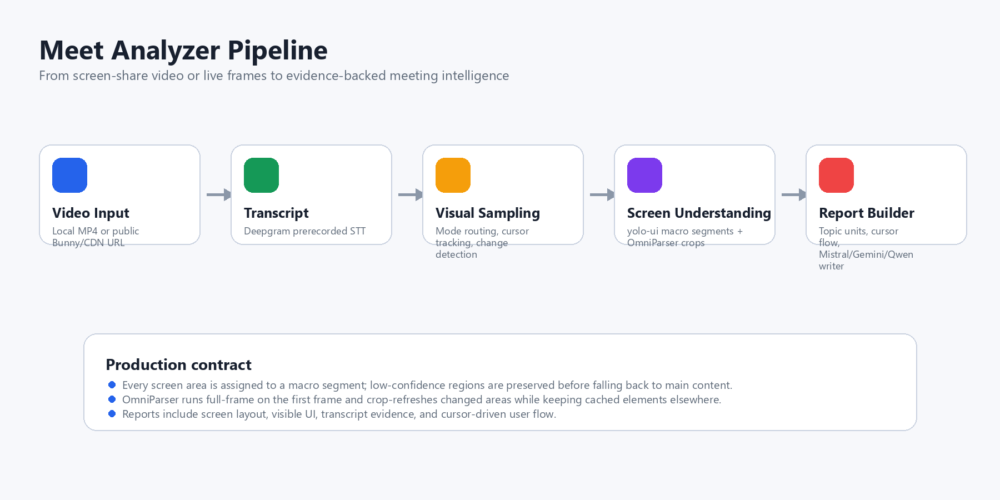

# Meet Analyzer

Meet Analyzer turns screen-share meetings into structured, evidence-backed reports. It connects what was said with what was visible — what changed on screen, which UI regions mattered, what the cursor was doing, and which evidence should survive into a final report.

The repository contains two analyzers that share the same visual understanding core:

| Mode | Folder | Primary use | Output |
| --- | --- | --- | --- |
| Batch analysis | [`batch_mode`](batch_mode) | Recorded meetings, demos, lecture walkthroughs, cluster GPU runs | `analysis.json`, `analysis_with_llm.json`, `report.md` |
| Real-time analysis | [`real_time_mode`](real_time_mode) | Live screen sharing, low-latency visual events, frontend monitoring | Live summaries, annotated frames, Supabase-ready event payloads |

## What It Does

Each processed frame is converted into a structured screen state:

- **Macro regions**: page header, left navigation/sidebar, main content, and coverage fallback regions.
- **Content blocks and readable text**: DocLayout-YOLO regions, OCR lines, code text, slide text, and UI text.
- **Cursor state**: pointer box, hotspot, movement direction, and nearest visual target.
- **Screen mode**: demo, slide, code, or other.
- **Transcript alignment**: speech windows attached to visual changes.
- **Report sections**: timeline, screen flow, topics, decisions, and transcript.

<p align="center">
  
</p>

---

## Validation Source

All evidence assets below were generated from this Bunny CDN sample:

```text
https://vz-e4eb54a1-90d.b-cdn.net/39864ba9-c74e-4cfa-a088-58ec2a08c699/play_480p.mp4
```

This is a student project evaluation recording. A student named Ashima Jain presents a **Kabaddi Game AI simulation** (CSE 643 Sec A AI HW2) inside an ICAPP evaluation platform. The recording covers: a title screen, game rules, the simulation environment, an agent table, and algorithm logic. Five frames were sampled at 2s, 58s, 100s, 145s, and 205s.

The macro sheet shows the five states with yolo-ui region boxes. The duplicate 15s title-frame sample was removed.

<p align="center">
  
</p>

The micro sheet shows OmniParser v2 micro element boxes on the same frames.

<p align="center">
  
</p>

---

## Model Stack

| Layer | Model / implementation | Role |
| --- | --- | --- |
| Screen mode routing | `google/siglip-base-patch16-224` (or `siglip2-large-patch16-384`) with positive-minus-negative prompt bank | Routes frames into demo, slide, code, or other |
| Sticky routing guard | Confidence floors, consecutive-frame confirmation, demo guard margin | Prevents rapid mode flapping during transitions |
| Macro layout | `swaylenhayes/uitag-yolo11s-ui-detect-v1` (`yolo-ui.pt`) — tiled inference, class-aware NMS, geometry conversion | Detects header / sidebar / main-content regions and suppresses false sidebars |
| Content block detection | `juliozhao/DocLayout-YOLO-DocStructBench` (`doclayout_yolo_docstructbench_imgsz1024.pt`) | Extracts text blocks, figures, tables, formulas, captions, lists |
| Micro element detection | `microsoft/OmniParser-v2.0` — icon detector + Florence-2 caption model | Finds icons, buttons, tabs, inputs, text labels with captions |
| OCR | EasyOCR (GPU), RapidOCR (CPU), optional PaddleOCR — per-mode upscaling, crop-then-rebase | Reads code, slide, and UI text |
| Slide understanding | Surya layout + OCR predictors with SHA-256 fingerprint + OCR fallback | Slide blocks, reading order, title, duplicate-slide detection |
| Cursor tracking | Custom YOLO (`cursor_class_best.pt`) + template matching + motion prediction | Tracks pointer and attaches cursor to UI elements and macro regions |
| Change detection | SSIM + pixel-ratio diff, cursor-masked, per-mode thresholds, changed-region crops | Skips unchanged frames; sends only changed crops to models |
| Topic segmentation | `BAAI/bge-m3` via sentence-transformers + cosine similarity clustering | Groups frame events into time-bounded topic units |
| Global topic linking | Cross-unit pairwise similarity > 0.69 threshold | Identifies recurring themes across the full video |
| Transcription | Deepgram nova-3 (prerecorded, with diarization and smart formatting) | Provides speaker-attributed transcript with utterance timestamps |
| Frame LLM descriptions | `unsloth/Mistral-Small-24B-Instruct-2501-unsloth-bnb-4bit` / `Qwen/Qwen3-30B-A3B-FP8` / `gemini-2.5-flash` / vLLM | Per-frame detailed descriptions of code, slides, and demo regions |
| Report writer | Same model options as frame LLM, plus mock deterministic writer | Generates `report.md` from structured section evidence |

---

## Batch Mode Pipeline

Batch mode processes a video end-to-end and produces `analysis.json` before any LLM call, then writes `analysis_with_llm.json` and `report.md` after the LLM stages.

```text
Video URL / local MP4
  → source resolver + downloader (streaming, no re-encode)
  → Deepgram nova-3 transcription  ─┐  (parallel threads)
  → frame sampling (BATCH_SAMPLE_FPS) ─┘
  → SigLIP: demo / slide / code / other
  → cursor YOLO → cursor masking before SSIM diff
  → SSIM + pixel-ratio change detection (per-mode thresholds)
  → [demo]  yolo-ui macro layout (tiled, class-aware NMS)
  → [demo]  DocLayout-YOLO on changed crops → rebase to full frame
  → [demo]  OmniParser v2 on changed crops → rebase to full frame
  → [slide] Surya layout + OCR → SHA-256 fingerprint → skip duplicates
  → [code]  EasyOCR/RapidOCR full-frame → diff vs previous frame
  → state merge (IoU + text continuity) + containment hierarchy
  → transcript window attachment
  ↓
  analysis.json written here  ← pre-LLM, always produced
  ↓
  → frame-level LLM pass (parallel workers, per-mode prompts)
  → BGE-M3 topic segmentation + global topic linking
  → report section builder (prewritten narrative + LLM synthesis)
  → analysis_with_llm.json + report.md
```

**`analysis.json` is always written first** — before any LLM call. If the LLM stage fails or is skipped, the complete structural analysis is already on disk and can be used to re-run the report writer with a different backend.

### All Models — What They Produce

| Model | Output field in `analysis.json` | Example output |
| --- | --- | --- |
| SigLIP mode router | `frame_events[*].mode`, `visual_payload.confidence.route` | Mode label + per-class scores + `decision_path` |
| Custom cursor YOLO (`cursor_class_best.pt`) | `frame_events[*].cursor`, `visual_payload.cursor_target`, `cursor_action` | Cursor box, hotspot, nearest element, trail |
| SSIM + pixel diff | `visual_payload.change_type`, `change_ratio`, `ssim_score`, `changed_regions` | Changed crop boxes |
| yolo-ui (`swaylenhayes/uitag-yolo11s-ui-detect-v1`) | `visual_payload.macro_layout` | `header`, `left_sidebar`, `main_content` bounding boxes |
| DocLayout-YOLO | `visual_payload.doclayout_elements` | `text_block`, `figure`, `table`, `caption`, `formula` blocks |
| OmniParser v2 | `visual_payload.micro_elements` | Icons, buttons, tabs, inputs with captions |
| EasyOCR / RapidOCR | `visual_payload.ocr_text`, `ocr_lines`, `ocr_diff` | Per-line text boxes with confidence |
| Surya | `visual_payload.layout`, `full_text`, `slide_fingerprint` | Layout blocks with reading order |
| BGE-M3 embeddings | `topic_units`, `topic_clusters` | Time-bounded topic segments + cross-unit clusters |
| Frame LLM (Mistral / Qwen / Gemini) | `visual_payload.llm_detail` | Per-region structured descriptions |
| Section writer LLM | `llm_output.final_markdown` | `report.md` |

<p align="center">
  
</p>

<p align="center">
  
</p>

<p align="center">
  
</p>

### Validation Numbers

Macro page segmentation (5 Bunny frames):

| Metric | Value |
| --- | ---: |
| Sampled frames | `5` |
| Sample timestamps | `2s, 58s, 100s, 145s, 205s` |
| Mean grid coverage | `100.00%` |
| High-confidence regions | `11` |
| Low-confidence retained | `4` |
| Detected classes | `header`, `left_sidebar`, `main_content` |

<p align="center">
  
</p>

OmniParser micro element extraction (5 Bunny frames):

| Metric | Value |
| --- | ---: |
| Parsed frames | `5` |
| Elements detected | `296` |
| Mean per frame | `59.2` |
| Interactive elements | `259` |
| Elements with captions | `296` |

<p align="center">
  
</p>

---

## Cluster Mode

Batch mode has a Slurm-backed cluster path. The login node downloads the video and runs Deepgram transcription (which needs internet). The GPU compute node runs all model inference (which needs VRAM but not internet, since models are pre-downloaded).

**Single job — direct shell script** (run on the cluster login node):

```bash
cd /path/to/Meet-Analyzer
cp batch_mode/.env.example batch_mode/.env
# Edit batch_mode/.env with your cluster paths, API keys, partition, conda env, and writer backend

bash batch_mode/myproject/submit_cluster_source.sh \
  --writer mistral \
  "https://vz-e4eb54a1-90d.b-cdn.net/39864ba9-c74e-4cfa-a088-58ec2a08c699/play_480p.mp4" \
  bunny_480p.mp4
```

**Single job — via API** (from your local machine, API server must have cluster SSH access):

```bash
curl -s -X POST http://<server>:8000/api/analyze/cluster \
  -H 'Content-Type: application/json' \
  -d '{"source": "https://vz-e4eb54a1-90d.b-cdn.net/39864ba9-c74e-4cfa-a088-58ec2a08c699/play_480p.mp4", "title": "Bunny sample", "writer": "mistral"}'
```

**Sequential batch — multiple videos**:

```bash
bash batch_mode/myproject/submit_cluster_batch.sh \
  --writer qwen \
  "https://vz-e4eb54a1-90d.b-cdn.net/39864ba9-c74e-4cfa-a088-58ec2a08c699/play_480p.mp4" \
  /path/to/another.mp4

# Or from a file:
bash batch_mode/myproject/submit_cluster_batch.sh --writer mistral --file links.txt
```

**vLLM Qwen server** (optional — start once, use across many jobs):

```bash
sbatch batch_mode/myproject/sbatch_script/qwen_vllm_server.sh
# Then set BATCH_LLM_BACKEND=vllm and BATCH_LLM_BASE_URL=http://<node>:8000/v1
```

**Fetch results**:

```bash
curl "http://<server>:8000/api/jobs/<request_id>/result?download=true" -o analysis.json
curl "http://<server>:8000/api/jobs/<request_id>/report?download=true" -o report.md
curl http://<server>:8000/api/jobs
```

Cluster environment variables in `batch_mode/.env`:

```env
BATCH_CLUSTER_HOST=<cluster-hostname>
BATCH_CLUSTER_USER=<your-username>
BATCH_CLUSTER_ACCOUNT=<slurm-account>
BATCH_CLUSTER_CONDA_ENV=torch_clean
BATCH_CLUSTER_PARTITION=short
BATCH_CLUSTER_GRES=gpu:3g.40gb:1
BATCH_CLUSTER_PROJECT_DIR=/path/to/Meet-Analyzer
BATCH_CLUSTER_LOG_DIR=/path/to/Meet-Analyzer/batch_mode/myproject/logs
DOCLAYOUT_MODEL_REF=/path/to/doclayout_yolo_docstructbench_imgsz1024.pt
BATCH_LLM_MODEL=unsloth/Mistral-Small-24B-Instruct-2501-unsloth-bnb-4bit
BATCH_QWEN_MODEL_NAME=Qwen/Qwen3-30B-A3B-FP8
BATCH_EMBEDDING_MODEL=BAAI/bge-m3
BATCH_FRAME_DESCRIPTIONS_ENABLED=1
BATCH_FRAME_DESCRIPTION_WORKERS=6
```

---

## Repository Structure

```text
Meet-Analyzer
├── batch_mode/          # Offline analyzer, FastAPI API, Slurm submitter
├── real_time_mode/      # Live FastAPI app, frontend, Modal deployment
├── docs/assets/         # Macro/micro validation images and metric dashboards
├── docs/examples/       # Example reports and analysis snapshots
└── .env.example         # Minimal root template; mode-specific examples are preferred
```

---

## Quick Start

```bash
python -m venv .venv
source .venv/bin/activate
python -m pip install --upgrade pip
pip install -r batch_mode/requirements.txt
```

Windows PowerShell:

```powershell
python -m venv .venv
.\.venv\Scripts\Activate.ps1
python -m pip install --upgrade pip
pip install -r batch_mode\requirements.txt
```

Copy the mode-specific environment templates:

```bash
cp batch_mode/.env.example batch_mode/.env
cp real_time_mode/.env.example real_time_mode/.env
```

---

## Committed and Downloaded Artifacts

Small model files that make the project runnable without any download are committed. Larger Hugging Face checkpoints are cached on first warmup.

| Artifact | Path | Downloaded from |
| --- | --- | --- |
| yolo-ui detector | `real_time_mode/vendor/uitag/yolo-ui.pt` | Committed — `swaylenhayes/uitag-yolo11s-ui-detect-v1` |
| Cursor detector | `batch_mode/cursor_class_best.pt`, `real_time_mode/cursor_class_best.pt` | Committed — custom trained |
| OmniParser icon detector | `batch_mode/vendor/OmniParser/weights/icon_detect/model.pt` | Committed — `microsoft/OmniParser-v2.0` |
| OmniParser caption model | `batch_mode/vendor/OmniParser/weights/icon_caption/model.safetensors` | Must download — `microsoft/OmniParser-v2.0` |
| DocLayout-YOLO | `~/.cache/huggingface/hub/...` | Auto-download on first warmup — `juliozhao/DocLayout-YOLO-DocStructBench` |
| BGE-M3 | `~/.cache/huggingface/hub/...` | Auto-download on first warmup — `BAAI/bge-m3` |
| Mistral-Small-24B | `~/.cache/huggingface/hub/...` | Auto-download on first warmup — `unsloth/Mistral-Small-24B-Instruct-2501-unsloth-bnb-4bit` |
| Qwen3-30B-A3B-FP8 | `~/.cache/huggingface/hub/...` | Auto-download on first warmup — `Qwen/Qwen3-30B-A3B-FP8` |

---

## Real-Time Startup

```bash
python -m uvicorn real_time_mode.live_app:app --host 127.0.0.1 --port 8765
```

Then open `http://127.0.0.1:8765`, click **Start Session + Share**, and choose the window to analyze. The browser posts frames to the local `/api/process-frame`; the local app proxies heavy work to Modal when `MODAL_API_BASE_URL` is set.

Deploy/update Modal after changing backend pipeline code:

```powershell
$env:PYTHONIOENCODING='utf-8'
python -m modal deploy real_time_mode/modal_app.py
```

Recommended live settings in `real_time_mode/.env`:

```env
MODAL_API_BASE_URL=https://<your-modal-fastapi-app>.modal.run
VITE_CAPTURE_MAX_SIDE=1920
VITE_FRAME_REQUEST_TIMEOUT_MS=120000
FRAME_SUMMARIZER_ENABLED=1
FRAME_SUMMARIZER_DEVICE=disabled
FRAME_SUMMARIZER_TIMEOUT_SEC=5.0
```

`FRAME_SUMMARIZER_TIMEOUT_SEC=5.0` is important for live use. The visual pipeline builds a heuristic summary before calling an LLM. If the LLM takes longer than 5 seconds, the frame returns immediately with the heuristic summary plus model/OCR/layout output instead of leaving the UI waiting.

<p align="center">
  
</p>

---

## Reproduce Validation Assets

When the Bunny URL is reachable:

```bash
python docs/generate_segment_validation.py \
  --source "https://vz-e4eb54a1-90d.b-cdn.net/39864ba9-c74e-4cfa-a088-58ec2a08c699/play_480p.mp4" \
  --output-dir docs/assets \
  --times "2,58,100,145,205" \
  --weights real_time_mode/vendor/uitag/yolo-ui.pt \
  --device cpu
```

When the raw frames are already in `docs/assets/`:

```bash
python docs/generate_segment_validation.py \
  --raw-frames "docs/assets/frame_0002_raw.jpg,docs/assets/frame_0058_raw.jpg,docs/assets/frame_0100_raw.jpg,docs/assets/frame_0145_raw.jpg,docs/assets/frame_0205_raw.jpg" \
  --output-dir docs/assets \
  --weights real_time_mode/vendor/uitag/yolo-ui.pt \
  --device cpu
```

OmniParser micro validation (requires the downloaded caption model):

```bash
python docs/generate_micro_validation.py \
  --frames "docs/assets/frame_0002_raw.jpg,docs/assets/frame_0058_raw.jpg,docs/assets/frame_0100_raw.jpg,docs/assets/frame_0145_raw.jpg,docs/assets/frame_0205_raw.jpg" \
  --output-dir docs/assets \
  --repo-dir real_time_mode/vendor/OmniParser \
  --weights-dir real_time_mode/vendor/OmniParser/weights \
  --imgsz 512

python docs/build_readme_assets.py
```

---

## Verification

Current local test results:

```text
52 passed, 4 third-party deprecation warnings
```

The tests cover batch report assembly, page segmentation, cursor handling, mode routing, stale-frame dropping, frontend concurrency behavior, crop rebasing, sidebar false-positive guards, transcript handling, and the Surya enable/disable flag.

---

## More Details

- [`batch_mode/README.md`](batch_mode/README.md) — full step-by-step pipeline, every model with modifications and outputs, cluster setup, architectural decisions
- [`real_time_mode/README.md`](real_time_mode/README.md) — live pipeline, Modal deployment, frontend usage
