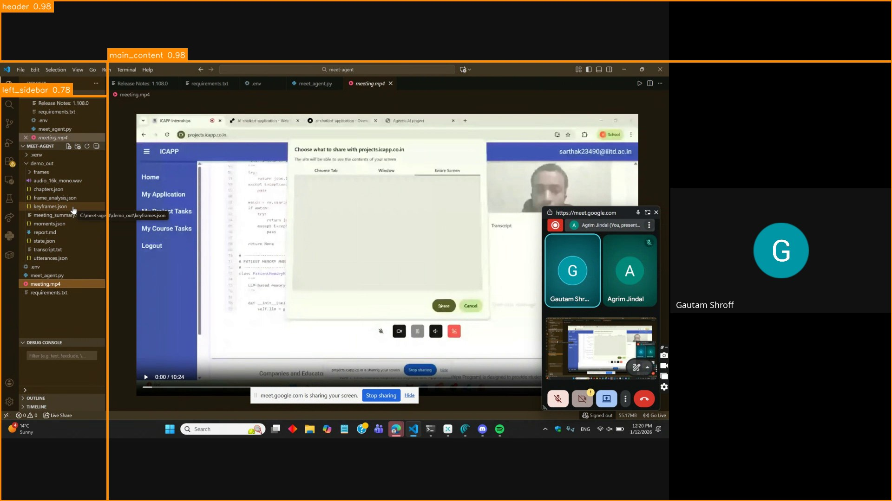
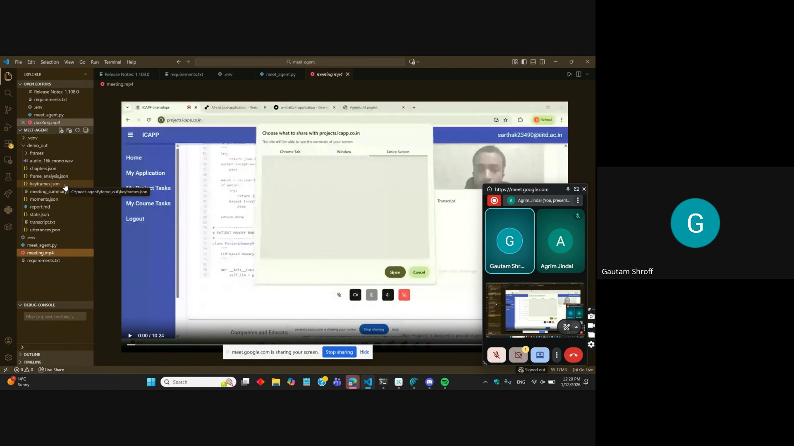
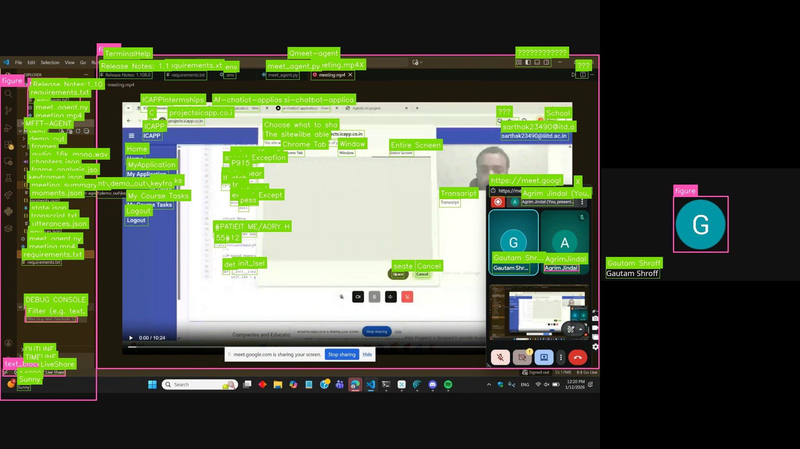
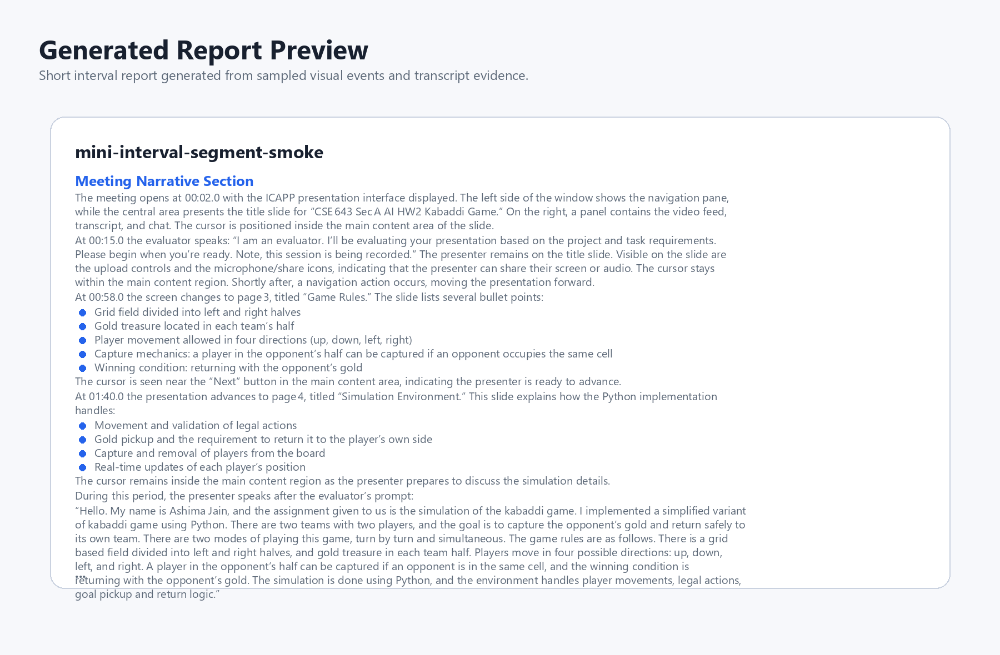

# Batch Mode

Batch mode is the offline pipeline for recorded screen-share meetings. It turns a public MP4 URL or local video into structured visual events, transcript-linked state changes, frame-level descriptions, topic units, and a final Markdown report.

## Validation Source

All validation assets in this repository use the following Bunny CDN sample:

```text
https://vz-e4eb54a1-90d.b-cdn.net/39864ba9-c74e-4cfa-a088-58ec2a08c699/play_480p.mp4
```

This video is a student project presentation recorded inside an ICAPP (Internship/Course Application Platform) session. A student named Ashima Jain presents a Kabaddi Game AI simulation for **CSE 643 Sec A AI HW2**. The recording walks through: a title screen, game rules, the simulation environment, a table of agents, and the algorithm logic. This is a course evaluation recording — the student shares their screen while speaking, with the ICAPP platform visible around the shared content. Five states were sampled for validation: at 2s, 58s, 100s, 145s, and 205s.

<p align="center">
  
</p>

<p align="center">
  
</p>

---

## What The Results Show

From the `analysis.json` produced on this video you can immediately identify the meeting content:

- **mode per frame**: `demo` throughout (ICAPP is a web app), occasionally `slide` when slide content dominates
- **macro_layout**: consistently a `header` (ICAPP top bar), `left_sidebar` (My Application, My Project Tasks, My Course Tasks, Logout), and `main_content` (the slide/simulation canvas)
- **ocr_text and doclayout_elements**: title text reads "CSE 643 Sec A AI HW2 Kabaddi Game" and "Ashima Jain" on the opening frame; subsequent frames contain rule text, agent tables, and pseudocode
- **cursor_target**: confirms the student is clicking through a slide deck embedded in ICAPP main content
- **transcript_window**: audio segments refer to kabaddi rules, agent strategies, and reward functions

Anyone reading the JSON can tell: this is a course project evaluation — a student presenting an AI-driven kabaddi game simulation inside an ICAPP evaluation platform.

---

## Output Files

The pipeline writes **`analysis.json` first**, before any LLM call. The LLM frame descriptions and the report writer run after. This means you always have the complete structural analysis even if LLM calls fail or are skipped.

```text
batch_mode/outputs/<video-stem>/
├── analysis.json           # Written immediately after visual + transcript processing. No LLM content.
├── analysis_with_llm.json  # Written after frame LLM pass and report LLM. Contains llm_detail fields.
└── report.md               # Human-readable Markdown report from the section writer.
```

The `artifact_stage` field inside the JSON tells you which phase produced it:

| File | `artifact_stage` | LLM content |
| --- | --- | --- |
| `analysis.json` | `pre_llm` | `"status": "not_started"` |
| `analysis_with_llm.json` | `post_llm` | Full `llm_detail`, topics, report sections |

Important fields in `analysis.json`:

| Field | What it contains |
| --- | --- |
| `frame_events` | Per-frame screen state, visual payload, cursor, transcript window |
| `topic_units` | Time-bounded topic segments built from BGE-M3 embeddings |
| `topic_clusters` | Cross-unit semantic clusters from the global linker |
| `report_sections` | Prewritten narrative, slide section, code section, demo section, decisions |
| `profiling` | Per-stage elapsed time in seconds |

---

## Pipeline Overview

```text
Video URL / local MP4
  → source resolver + downloader
  → Deepgram nova-3 transcription  ─┐  (parallel)
  → frame sampling (BATCH_SAMPLE_FPS) ─┘
  → SigLIP mode router: demo / slide / code / other
  → cursor YOLO detector → cursor masking before diff
  → SSIM + pixel-ratio change detection (per-mode thresholds)
  → [demo] yolo-ui macro layout (tiled, class-aware NMS)
  → [demo] DocLayout-YOLO block extraction on changed crops
  → [demo] OmniParser v2 icon/element detection on changed crops
  → [slide] Surya layout + OCR → slide fingerprint
  → [code]  EasyOCR/RapidOCR full-frame + diff vs previous frame
  → changed-region cache + state merge + IoU/text-continuity dedup
  → macro → DocLayout/OmniParser/OCR containment hierarchy
  → transcript window attachment
  ↓
  analysis.json written here  ← pre-LLM, always produced
  ↓
  → frame-level LLM pass (Mistral / Qwen / Gemini, parallel workers)
  → BGE-M3 topic segmentation + global topic linking
  → report section builder
  → section writer LLM (Mistral / Qwen / Gemini / mock)
  → analysis_with_llm.json + report.md
```

---

## Step-By-Step: Local / API Mode

### Stage 1 — Source Resolution and Download

Public URLs (Bunny CDN, direct HTTP/HTTPS MP4 links) are downloaded to `BATCH_TEMP_DIR` using streaming requests with a configurable timeout (`BATCH_DOWNLOAD_TIMEOUT_SEC`, default 600s). Local files are used directly. No preprocessing or re-encoding is done — the original MP4 is passed straight to OpenCV.

**Architectural decision**: the video is never decoded all at once. OpenCV frame-seeks are used in sequential-FPS mode (grab-skip frames between targets) so only sampled frames are decoded.

---

### Stage 2 — Transcription: Deepgram nova-3

**Model**: [Deepgram nova-3](https://developers.deepgram.com/docs/models) (prerecorded API)

**What it does**: transcribes the full audio track with speaker diarization, smart formatting, punctuation, and utterance-level timestamps.

**Options used**: `model=nova-3`, `smart_format=True`, `punctuate=True`, `utterances=True`, `diarize=True`.

Transcription and visual frame analysis run **in parallel** using a `ThreadPoolExecutor(max_workers=2)` — the download step finishes first, then both the STT adapter and the frame pipeline start at the same time.

If Deepgram fails or no API key is set, the pipeline continues without a transcript. Transcript segments supplied in the request body skip this stage entirely.

**Output in `analysis.json`**: `transcript_segments` — list of utterances with start, end, speaker, and text; `frame_events[*].transcript_window` — the speech segments since the previous visual event.

---

### Stage 3 — Frame Sampling and Mode Routing: SigLIP

**Model**: `google/siglip-base-patch16-224` (default; override with `SIGLIP_MODEL_NAME`, e.g. `google/siglip2-large-patch16-384`)

**What it does**: classifies each sampled frame into one of four modes: `demo`, `slide`, `code`, or `other`. This drives all downstream processing — a demo frame runs macro layout + OmniParser, a slide frame runs Surya, a code frame runs full-frame OCR.

**Modifications made**:

1. **Positive-minus-negative prompt bank**: instead of the standard zero-shot single-label approach, each class has a bank of positive prompts and negative prompts. The score for a class is `mean(similarity(image, pos_prompts)) − mean(similarity(image, neg_prompts))`. This prevents slides with embedded code screenshots from being misrouted as `code`, and prevents demo apps with code-heavy UI text from being misrouted as `code`.

2. **Sticky routing with three tiers**:
   - **Immediate switch** (confidence ≥ 0.82): mode changes in one frame.
   - **Consecutive-frame confirmation** (2 frames required): medium-confidence predictions must appear twice in a row before the mode switches.
   - **Low-confidence hold** (confidence < 0.48): previous stable mode is kept.

3. **Demo guard margin**: if the current stable mode is `demo` and a non-demo prediction arrives with a score within 0.06 of the demo score, demo is held. This prevents brief UI state changes (like a text tooltip appearing) from triggering a mode flip.

4. **On cluster runs**: SigLIP is disabled by default (`BATCH_DISABLE_SIGLIP=1`) and replaced by OCR route guards only (code regex patterns + slide term matching), because the cluster transcribes on the login node then submits only visual inference to the GPU.

**Output in `analysis.json`**: `frame_events[*].mode`, `frame_events[*].visual_payload.confidence.route` with per-class scores and the `decision_path` string that explains which tier triggered the switch.

<p align="center">
  
</p>

---

### Stage 4 — Cursor Detection and Masking: Custom YOLO

**Model**: `cursor_class_best.pt` — a custom-trained YOLOv8/YOLO11 cursor detector, committed at `batch_mode/cursor_class_best.pt` and `real_time_mode/cursor_class_best.pt`. It detects the mouse pointer bounding box and cursor type.

**What it does**: finds the cursor in each frame, determines the hotspot (top-left corner of the cursor bounding box by default), identifies the nearest UI element under the hotspot, and links the cursor to its parent macro region.

**Modifications and design decisions**:

1. **Template matching fallback**: if the YOLO model misses the cursor, a multi-scale template matching pass runs against a bank of built-in cursor templates (standard arrow, hand, I-beam, crosshair). A local-region template search also runs around the previous known cursor position.

2. **Motion prediction**: if YOLO and templates both miss for up to 3 consecutive frames, the cursor position is extrapolated by applying the last known trail delta (dx, dy) to the previous bounding box. Confidence decays to 55% of the previous value per missed frame.

3. **Cursor masking before change detection**: the cursor bounding box (plus `CURSOR_MASK_PADDING_PX=8` pixels on each side) is inpainted with the surrounding pixel average before the SSIM and pixel-diff pass. This prevents the cursor moving across a stable frame from triggering a false visual change event.

4. **Element proximity**: the hotspot is checked against all detected UI elements. If the hotspot lands inside an element's bounding box (with 4px padding), that element is tagged as the cursor target. If no element is hit, the 12px-expanded cursor box is intersected against all elements for a loose match.

**Output in `analysis.json`**: `frame_events[*].cursor` with `detected`, `bbox`, `hotspot`, `method`, `tracking_state`, `motion_type`, `trail`, `near_element_id`; `frame_events[*].visual_payload.cursor_target` and `cursor_action` text.

<p align="center">
  
</p>

---

### Stage 5 — Change Detection: SSIM + Pixel Diff

**No external model — pure OpenCV computation.**

**What it does**: compares the current frame (cursor-masked) against the previous frame for the same mode. If the frame has not changed enough, it is skipped entirely — no layout, no OCR, no OmniParser.

**How it works**: a pixel-difference map is computed after converting to grayscale. Changed pixels (absolute difference > `CHANGE_PIXEL_THRESHOLD=18`) are counted. The change ratio is the fraction of changed pixels. SSIM (structural similarity, from scikit-image) is computed over the full frame. A frame is marked as changed if either the change ratio exceeds the mode-specific tiny threshold or SSIM falls below the mode-specific threshold.

**Per-mode thresholds**:

| Mode | Change ratio threshold | SSIM threshold |
| --- | --- | --- |
| `code` | 0.0004 (4 in 10,000 pixels) | 0.9985 |
| `slide` | 0.015 | 0.9920 |
| `demo` | 0.0010 | 0.9965 |

Code mode has the tightest ratio threshold — a single character change in an editor triggers a new visual event.

**Changed region extraction**: connected components of changed pixels are extracted, padded by `CHANGE_PADDING_PX=10`, and merged into rectangular crops. Changed crops are used for all downstream model inference — DocLayout-YOLO, OmniParser, and OCR only run on the changed regions, not the full frame.

**Boundary change check**: if the changed-pixel ratio exceeds `MACRO_GLOBAL_CHANGE_RATIO=0.35`, the macro layout is re-detected from scratch. If it is below that, the previous macro layout is kept and only the changed crops are reparsed.

**Output in `analysis.json`**: `frame_events[*].visual_payload.change_type` (`initial`, `content`, `boundary`, `none`), `visual_payload.change_ratio`, `visual_payload.ssim_score`, `visual_payload.changed_regions`.

---

### Stage 6 — Macro Layout Detection: yolo-ui

**Model**: `swaylenhayes/uitag-yolo11s-ui-detect-v1`, committed as `real_time_mode/vendor/uitag/yolo-ui.pt` (also symlinked/copied into `batch_mode/vendor/uitag/`). This is a YOLO11s model trained on UI screenshots to detect navigation bars, sidebars, menus, buttons, and other structural page elements.

**What it does**: detects which regions of the frame are the page header, left sidebar, right sidebar, main content, and footer. These become the top-level nodes in the visual evidence hierarchy.

**Modifications made**:

1. **Tiled inference**: the frame is split into 640×640 tiles with a 512-pixel step. Each tile is inferred independently and detections are rebased to full-frame coordinates. This lets the model handle 1920×1080 screens (which are 3× wider than its training images) without aggressive downscaling.

2. **Class-aware NMS**: standard NMS is applied per class (e.g. two overlapping `sidebar` boxes are merged, but a `sidebar` and a `navigation` box at the same position are both kept for the geometry pass). Boxes smaller than 4×4 pixels are dropped.

3. **Geometry-to-region conversion**: raw class detections are not used directly. An `estimate_coarse_regions` pass converts detections into five fixed-slot regions (`header`, `left_sidebar`, `right_sidebar`, `footer`, `main_content`) using position rules:
   - Header: center-y < 22% of layout height and class is navigation/menu/input/button
   - Footer: center-y > 82% of layout height and class is information_display/menu/navigation/others
   - Left sidebar: center-x < 35% of frame width, rail-like geometry (compact width, vertical extent), class is sidebar/navigation/menu
   - Right sidebar: same rules mirrored to the right 35%
   - Main content: computed as the remaining space after header, footer, and sidebars are placed

4. **Sidebar false-positive suppression**: a sidebar candidate must pass `_is_side_rail_candidate` — it must be narrower than 40% of frame width, taller than 20% of frame height, and positioned at the left or right edge. This prevents wide content panels from being classified as sidebars.

5. **Boundary evidence refinement**: after the coarse regions are placed, `refine_regions_from_boundary_evidence` scans the raw detections for boxes that straddle region boundaries and adjusts the boundaries by up to `MACRO_BOUNDARY_OVERLAP=5%` of frame size to better align with actual content edges.

6. **Coverage fallback**: if any screen area is not covered by a detected region, it is assigned to `main_content` using a grid-coverage pass. This guarantees that 100% of the screen belongs to some macro region.

7. **Low-confidence retained regions**: regions detected with confidence below `UI_REGION_CONFIDENCE_THRESHOLD=0.75` are kept but tagged with source `uitag-yolo-lowconf` rather than `uitag-yolo`, so downstream processing can treat them with less certainty.

**Output in `analysis.json`**: `frame_events[*].visual_payload.macro_layout` — list of objects with `id`, `type`, `label`, `bbox`, `confidence`, `source`.

<p align="center">
  
</p>

<p align="center">
  
</p>

| Metric | Value |
| --- | ---: |
| Sampled frames | `5` |
| Sample timestamps | `2s, 58s, 100s, 145s, 205s` |
| Mean grid coverage | `100.00%` |
| High-confidence regions | `11` |
| Low-confidence retained regions | `4` |

| Class | Detected frames | Example score |
| --- | ---: | ---: |
| `header` | `5 / 5` | `0.8049` |
| `left_sidebar` | `5 / 5` | `0.7755` |
| `main_content` | `5 / 5` | `0.8049` |

---

### Stage 7 — DocLayout-YOLO Block Extraction

**Model**: `juliozhao/DocLayout-YOLO-DocStructBench` — `doclayout_yolo_docstructbench_imgsz1024.pt`, downloaded from Hugging Face on first warmup using `hf_hub_download`. Override the path with `DOCLAYOUT_MODEL_REF`. This is a YOLOv10-based model trained on DocStructBench to detect document and UI layout blocks.

**What it does**: extracts coarse content-block bounding boxes from the frame or from the changed crops. Block types include: `text_block`, `title`, `figure`, `table`, `caption`, `formula`, `list`, `abandon`.

**Modifications made**:

1. **Crop-then-rebase**: DocLayout is run on the same changed crops produced by the change-detection stage, not the full frame. Each crop's detection boxes are shifted back to full-frame coordinates using the crop's (x1, y1) offset.

2. **Label normalization**: raw DocLayout-YOLO class names are mapped to a cleaner set. `plain_text` → `text_block`; `isolate_formula` → `formula`; `figure_caption` → `caption`; etc. `abandon` and `background` are dropped.

3. **Deduplication by IoU**: after all crop results are collected, overlapping boxes with IoU > 0.5 and the same type are merged to the highest-confidence one. This removes duplicates that appear when two adjacent crops overlap.

4. **Background filtering**: blocks with very high overlap with the full-frame bounding box (coverage > 95%) are treated as spurious full-image detections and dropped.

5. **imgsz=1024**: inference runs at 1024px regardless of input size, matching the model's DocStructBench training resolution.

**Output in `analysis.json`**: `frame_events[*].visual_payload.doclayout_elements` — list of `UIElement` objects with `id`, `type` (normalized label), `bbox`, `confidence`, `source=doclayout_yolo`; `visual_payload.confidence.doclayout_provider`.

<p align="center">
  
</p>

---

### Stage 8 — OmniParser v2 Micro Element Detection

**Model**: `microsoft/OmniParser-v2.0` — two components:
- **Icon detector** (`icon_detect/model.pt`): a fine-tuned YOLO model that finds interactive UI controls, icons, text boxes, and buttons.
- **Icon caption model** (`icon_caption/model.safetensors`): a Florence-2 derived vision-language model that generates a short text caption for each detected element crop.

The icon detector weights are committed at `batch_mode/vendor/OmniParser/weights/icon_detect/model.pt`. The caption model weights must be downloaded separately (see Setup section below).

**What it does**: given a frame or crop, detects all micro-level UI elements (icons, buttons, tabs, inputs, text labels) with their bounding boxes and text captions.

**Modifications made**:

1. **Crop-then-rebase**: OmniParser is run on changed crops, not the full frame. Each element's `bbox` is shifted from crop coordinates to full-frame coordinates using the crop offset.

2. **Type normalization**: the caption model's output and the detector's class labels are mapped to a canonical set: `button`, `icon`, `text`, `input`, `tab`, `link`, `checkbox`, `menu`, `toolbar`.

3. **Interactive flag**: types in the `INTERACTIVE_LABELS` set (`button`, `icon`, `toolbar`, `input`, `menu`, `tab`, `checkbox`, `link`) are marked `interactive=True`. This field is used by the cursor proximity logic and by LLM prompts.

4. **IoU/text-continuity merge with cache**: new OmniParser detections are compared against the previous frame's cached elements. An element is carried forward if IoU > threshold and text matches, rather than generating a new element ID. This prevents the element list from flickering every frame.

5. **Overlay detection**: elements whose captions contain modal/popup/dialog/dropdown/tooltip keywords are tagged as overlays rather than standard elements.

6. **Per-region parsing**: `parse_regions` sends each changed crop to OmniParser independently, collecting results across all regions and rebasing each to full-frame coordinates.

**Output in `analysis.json`**: `frame_events[*].visual_payload.micro_elements` — list of `UIElement` objects with `source=omniparser-v2.0`, `caption`, `interactive`, `type`, `bbox`.

<p align="center">
  
</p>

<p align="center">
  
</p>

| Metric | Value |
| --- | ---: |
| Parsed Bunny frames | `5` |
| OmniParser elements | `296` |
| Mean elements per frame | `59.2` |
| Interactive elements | `259` |
| Elements with text or caption | `296` |

| Type | Count |
| --- | ---: |
| `icon` | `234` |
| `text` | `37` |
| `button` | `21` |
| `tab` | `3` |
| `input` | `1` |

---

### Stage 9 — OCR Text Extraction: EasyOCR / RapidOCR / PaddleOCR

**Models** (selected by `OCR_MODE` env var):
- **GPU mode** (`OCR_MODE=gpu`): [EasyOCR](https://github.com/JaidedAI/EasyOCR) with CUDA — best accuracy on dense/code text.
- **CPU mode** (`OCR_MODE=cpu`): [RapidOCR](https://github.com/RapidAI/RapidOCR) ONNX runtime — highest CPU throughput.
- **PaddleOCR**: optional third backend for legacy compatibility.

**What it does**: extracts all readable text from a frame or changed-region crops, returning per-line boxes with confidence scores.

**Modifications and clever tricks**:

1. **Per-frame-type upscaling**: before OCR, the crop or frame is upscaled by a global factor (1.25×) multiplied by a per-mode factor: code frames get an extra 1.20×, slides get 1.10×, demo gets 1.10×. The effective upscale for a code crop is 1.25 × 1.20 = 1.5×. This significantly improves recognition of small monospace code characters.

2. **Crop max scaling by type**: code frame crops skip resize entirely (`PARSE_MAX_W_CODE=99999` — effectively unlimited), so high-resolution code is never downsampled. Slide and demo crops are capped at 1280px wide.

3. **Region-then-rebase**: OCR is run on changed crops and each result box is shifted back to full-frame coordinates using the crop offset.

4. **Code mode diff**: for code frames specifically, the current OCR text is diffed against the previous frame's OCR text using Python's `difflib.ndiff`. Lines that changed or were added are extracted and stored as `ocr_diff` alongside the full `ocr_text`.

5. **Confidence filtering**: lines with confidence below `OCR_MIN_CONF=0.45` are dropped.

6. **Backend auto-selection**: `_choose_ocr_mode` reads `OCR_MODE`, `CUDA_VISIBLE_DEVICES`, and whether a CUDA device is available. If `OCR_MODE=gpu` but CUDA is not available, it falls back to CPU RapidOCR automatically.

**Output in `analysis.json`**: `frame_events[*].visual_payload.ocr_text` (full text string), `visual_payload.ocr_lines` (list of `{text, box, confidence}` dicts), `visual_payload.ocr_diff` (code-mode change lines only).

---

### Stage 10 — Surya Slide Analysis (slide mode only)

**Model**: [Surya](https://github.com/VikParuchuri/surya) layout and OCR predictors — `layout_predictor`, `recognition_predictor`, `detection_predictor`. Downloaded automatically by the `surya` pip package. Enabled by `SURYA_ENABLED=1` (default on).

**What it does**: for `slide` mode frames, Surya produces layout blocks with reading order (title, section header, text block, figure, table, caption), plus full slide text in reading order. This gives a more structured slide parse than plain OCR lines.

**Modifications and fallback**:

1. **SHA-256 slide fingerprint**: after Surya processes a slide, the full extracted text is hashed. If the next slide has the same fingerprint, it is skipped as a duplicate. This prevents adjacent identical slides from generating multiple identical visual events.

2. **OCR-derived fallback**: if Surya is not installed or fails, `build_slide_from_ocr_result` converts EasyOCR/RapidOCR lines into a `SlideAnalysis` object by sorting lines top-to-bottom, inferring the title as the highest/largest text block, and assigning layout types by position heuristics.

3. **State caching**: the previous Surya layout and text are cached. If the current slide produces the same fingerprint as the cached one, no new visual event is emitted.

**Output in `analysis.json`**: `frame_events[*].visual_payload.layout` (list of layout blocks with type, text, bbox, order), `visual_payload.full_text`, `visual_payload.slide_fingerprint`, `visual_payload.confidence.surya_provider`.

---

### Stage 11 — Hierarchy Assembly and Transcript Attachment

**No model — pure data structure logic.**

After all detections are collected for a frame, the pipeline builds a containment hierarchy:

1. **Macro region assignment**: every DocLayout, OmniParser, and OCR element is assigned to the macro region that most contains its bounding box. If an element overlaps multiple regions, it goes to the one with the highest overlap area.

2. **Parent-child nesting**: within each macro region, elements are sorted by area (largest first). A smaller element is nested under the nearest larger element that contains it. DocLayout blocks become parents over OmniParser elements; OmniParser elements become parents over OCR lines when positions overlap. Partial overlaps keep the nearby text as attached evidence without full nesting.

3. **Reading order**: each macro region receives a `children` list (top-to-bottom, left-to-right) and a flat `reading_order` list for report generation.

4. **Cursor attachment**: after the hierarchy is built, the cursor is attached to the exact element the hotspot lands on (if any), or to the macro region if no element matches.

5. **Transcript window**: the pipeline selects transcript segments whose end time is between the previous visual event and the current frame's timestamp (plus a `TRANSCRIPT_WINDOW_SEC=8.0` lookback). These are attached as `transcript_window` on the frame event.

6. **State merge**: newly parsed elements are merged with the cached state from the previous frame using IoU overlap and text-continuity matching. Elements that persist across frames carry their original ID; new elements get fresh IDs. This gives stable element IDs across the whole video.

**Output in `analysis.json`**: `frame_events[*].visual_payload.layout_groups` (hierarchy), `visual_payload.hierarchy`, `visual_payload.reading_order`, `frame_events[*].transcript_window`.

---

### Stage 12 — analysis.json Written Here

At this point — after frame sampling, all visual model inference, transcript alignment, and hierarchy assembly — the pipeline writes **`analysis.json`** with `artifact_stage: "pre_llm"` and `llm_output.status: "not_started"`. No LLM has been called yet.

This file is the complete structural record of the meeting regardless of what happens to the LLM stages. It can be used to:
- Replay the visual timeline without LLM costs
- Debug model outputs per frame
- Re-run the report writer on different LLM backends without re-processing the video

---

### Stage 13 — Frame-Level LLM Descriptions

**Models** (configurable via `BATCH_LLM_BACKEND` + `BATCH_LLM_MODEL`):
- `unsloth/Mistral-Small-24B-Instruct-2501-unsloth-bnb-4bit` — 4-bit quantized Mistral, loaded locally via HuggingFace Transformers (default)
- `Qwen/Qwen3-30B-A3B-FP8` — FP8 Qwen3 MoE, loaded locally or via a vLLM server
- `gemini-2.5-flash` — via Gemini API (`BATCH_LLM_BACKEND=gemini`)
- Any OpenAI-compatible endpoint via `BATCH_LLM_BASE_URL` (`BATCH_LLM_BACKEND=vllm`)
- `mock` — returns deterministic placeholder text for smoke testing

Enabled by `BATCH_FRAME_DESCRIPTIONS_ENABLED=1` (default). Frame LLM calls run in a `ThreadPoolExecutor` with up to `BATCH_FRAME_DESCRIPTION_WORKERS=6` parallel workers.

**Per-mode prompts**:

- **Code frames**: the prompt includes the OCR full text, the OCR diff from the previous frame, visible file paths, cursor context, and the previous frame's summary. The LLM describes the editor/terminal layout, visible code, what changed, and the likely reason.
- **Slide frames**: the prompt includes Surya layout blocks, full slide text, OCR lines, DocLayout elements, cursor position, and the previous frame's summary. The LLM describes the title, body content, figures/tables, and what changed from the last slide.
- **Demo frames**: the main content area is split into up to `BATCH_DEMO_MAIN_MAX_SEGMENTS=6` vertical subregions based on gaps between layout/OCR/OmniParser elements. Each region (`header`, `left_sidebar`, `right_sidebar`, `footer`, each main subregion) gets its own parallel LLM call. Then a `relationships` call explains how the segments relate spatially, and a final `page_summary` call explains what is happening, what changed, cursor flow, and the likely reason for the change.

**Demo output structure**: each demo frame produces a structured object — not a single string — with keys `header`, `left_sidebar`, `main_content`, `right_sidebar`, `footer`, `relationships`, `page_summary`. This is stored as `visual_payload.llm_detail`.

**Output in `analysis_with_llm.json`**: `frame_events[*].visual_payload.llm_detail` — per-mode structured description object.

<p align="center">
  
</p>

---

### Stage 14 — Topic Segmentation: BGE-M3 Embeddings

**Model**: `BAAI/bge-m3` — a multilingual dense embedding model via `sentence-transformers`. Loaded on `BATCH_EMBEDDING_DEVICE` (default `cuda`).

**What it does**: converts each frame event's text summary (combining OCR text, mode, transcript window, cursor context, and visual description) into a 1024-dimensional dense vector. These vectors are clustered into topic units.

**How topic segmentation works**:

1. Each frame event is embedded as a text blob combining its `summary`, `ocr_text`, `mode`, `transcript_window` speaker text, and cursor target description.
2. Adjacent events are grouped into a topic unit if their cosine similarity exceeds `BATCH_EMBEDDING_SIMILARITY_THRESHOLD=0.63` and the time gap is within `BATCH_SEGMENT_MAX_SEC=30.0` seconds.
3. Topic units are sized between `BATCH_SEGMENT_MIN_SEC=10.0` and `BATCH_SEGMENT_MAX_SEC=30.0` seconds (target: `BATCH_SEGMENT_TARGET_SEC=18.0`).

**Global topic linking**: after segmentation, `GlobalTopicLinker` computes pairwise cosine similarity between all topic units. Units whose mean vectors have similarity > `BATCH_TOPIC_SIMILARITY_THRESHOLD=0.69` are grouped into `topic_clusters`. This identifies recurring themes across the whole video — e.g. all frames showing the agent table get linked even if spread across the timeline.

**Lexical fallback**: if `sentence-transformers` is unavailable, a lexical embedding (8-dimensional bag-of-words over key terms) is used instead so the pipeline never fails completely.

**Output in `analysis_with_llm.json`**: `topic_units` — time-bounded units with start, end, dominant_class, event_ids, transcript_text, unit_summary; `topic_clusters` — cross-unit semantic groupings.

---

### Stage 15 — Report Generation: Section Writer LLM

**Models** (same options as Stage 13 — set with `--writer` flag or `writer` API field):
- `mistral` → `unsloth/Mistral-Small-24B-Instruct-2501-unsloth-bnb-4bit` (HF local, 4-bit quant)
- `qwen` → `Qwen/Qwen3-30B-A3B-FP8` (HF local or vLLM server)
- `gemini` → `gemini-2.5-flash` (Gemini API)
- `mock` → deterministic mock output for smoke tests

The section writer receives structured `report_sections` — prewritten narrative markdown, slide keyframes, code keyframes, demo events, chronological topic summary, topic clusters, decisions, and transcript excerpt — and generates the final `report.md`.

LLM prompt inputs are capped at `BATCH_LLM_MAX_PROMPT_CHARS=60000` (Mistral) / `80000` (Gemini) to stay within context limits. Sections can run in parallel with `BATCH_LLM_SECTION_WORKERS` workers.

**Prewritten sections that don't need LLM**: the meeting narrative, full transcript, and chronological section are assembled deterministically from the structured data and written to `report_sections.meeting_narrative_section.prewritten_markdown`. The LLM is only called for synthesis sections that benefit from generative prose.

**Mock/fallback**: if the LLM call fails, `MockSectionWriter` fills in the report with prewritten deterministic content and marks `llm_output.backend=fallback-mock`. The analysis JSON is still written with complete structural data.

**Output**: `analysis_with_llm.json` → `llm_output.final_markdown`; `report.md`.

---

## Step-By-Step: Cluster Mode

Cluster mode uses the same pipeline code but submits inference to Slurm GPU nodes instead of running locally. The login node handles network work (downloading the video, running Deepgram) and the GPU node handles all model inference.

### 1 — Source Preparation on Login Node

```bash
# Direct shell script (on the cluster login node):
bash batch_mode/myproject/submit_cluster_source.sh \
  --writer mistral \
  "https://vz-e4eb54a1-90d.b-cdn.net/39864ba9-c74e-4cfa-a088-58ec2a08c699/play_480p.mp4" \
  bunny_480p.mp4

# Or via API (from your local machine):
curl -s -X POST http://<server>:8000/api/analyze/cluster \
  -H 'Content-Type: application/json' \
  -d '{"source": "https://vz-e4eb54a1-90d.b-cdn.net/39864ba9-c74e-4cfa-a088-58ec2a08c699/play_480p.mp4", "title": "Bunny sample", "writer": "mistral"}'
```

The shell script:
1. Downloads the MP4 to `batch_mode/tmp/` on the login node using `curl -L`
2. Creates `batch_mode/cluster_jobs/<request_id>/` on the cluster
3. Runs `prepare_cluster_request.py` to call Deepgram (prerecorded) and write `request.json` with the transcript embedded
4. Submits `batch_mode/myproject/sbatch_script/script.sh` via `sbatch`

The API runner does the same steps over SSH using `paramiko`, then calls `sbatch --wrap` with all model/writer env vars inlined.

### 2 — Slurm Job on GPU Node (script.sh)

```bash
#SBATCH --gres=gpu:3g.40gb:1
#SBATCH --time=02:00:00
#SBATCH --mem=64G
#SBATCH --cpus-per-task=8
```

The job runs `batch_mode/myproject/test.py --request-json <path>` inside the conda env `torch_clean` (configurable via `BATCH_CLUSTER_CONDA_ENV`).

Environment variables set for the GPU node:

| Variable | Default in cluster mode |
| --- | --- |
| `BATCH_LLM_MODEL` | `unsloth/Mistral-Small-24B-Instruct-2501-unsloth-bnb-4bit` |
| `BATCH_QWEN_MODEL_NAME` | `Qwen/Qwen3-30B-A3B-FP8` |
| `BATCH_EMBEDDING_MODEL` | `BAAI/bge-m3` |
| `BATCH_LLM_BACKEND` | `hf-local` (or `vllm` if `BATCH_LLM_BASE_URL` is set) |
| `BATCH_DISABLE_SIGLIP` | `1` (OCR route guards used instead) |
| `HF_HUB_OFFLINE` | `1` (models must be pre-downloaded) |
| `DOCLAYOUT_ENABLED` | `1` |
| `DOCLAYOUT_MODEL_REF` | local path to `doclayout_yolo_docstructbench_imgsz1024.pt` |

### 3 — Sequential Batch Jobs

```bash
# Submit multiple videos sequentially (each job waits for the previous):
bash batch_mode/myproject/submit_cluster_batch.sh \
  --writer mistral \
  "https://vz-e4eb54a1-90d.b-cdn.net/39864ba9-c74e-4cfa-a088-58ec2a08c699/play_480p.mp4" \
  /path/to/another.mp4

# Or read from a file:
bash batch_mode/myproject/submit_cluster_batch.sh --writer qwen --file links.txt
```

Slurm job dependencies are chained with `--dependency=afterany:<job_id>` so jobs run one at a time. The API equivalent uses `submit_many` with `sequential=True`.

### 4 — Optional vLLM Server for Qwen

For high-throughput report writing on the cluster, Qwen can be served via vLLM as a separate Slurm job:

```bash
sbatch batch_mode/myproject/sbatch_script/qwen_vllm_server.sh
```

This starts a vLLM OpenAI-compatible server:
```bash
python -m vllm.entrypoints.openai.api_server \
  --model Qwen/Qwen3-30B-A3B-FP8 \
  --host 0.0.0.0 \
  --port 8000 \
  --trust-remote-code
```

Set `BATCH_LLM_BACKEND=vllm` and `BATCH_LLM_BASE_URL=http://<node>:8000/v1` in the analysis job to use it.

### 5 — Fetch Results

```bash
# Check job status:
curl http://<server>:8000/api/jobs/<request_id>

# Download analysis JSON:
curl "http://<server>:8000/api/jobs/<request_id>/result?download=true" -o analysis.json

# Download report:
curl "http://<server>:8000/api/jobs/<request_id>/report?download=true" -o report.md

# List all jobs:
curl http://<server>:8000/api/jobs

# Check Slurm queue:
curl http://<server>:8000/api/cluster/queue
```

---

## API Usage

Start the server:

```bash
python -m uvicorn batch_mode.api:app --host 0.0.0.0 --port 8000
```

**Health check** (shows active models and settings):

```bash
curl http://localhost:8000/health
```

**Single video, local pipeline** (blocks until complete):

```bash
curl -s -X POST http://localhost:8000/api/analyze \
  -H 'Content-Type: application/json' \
  -d '{
    "source": "https://vz-e4eb54a1-90d.b-cdn.net/39864ba9-c74e-4cfa-a088-58ec2a08c699/play_480p.mp4",
    "title": "Bunny sample",
    "writer": "mistral",
    "describe_frames": true
  }'
```

**Cluster submission** (returns job_id immediately, inference runs on Slurm):

```bash
curl -s -X POST http://localhost:8000/api/analyze/cluster \
  -H 'Content-Type: application/json' \
  -d '{
    "source": "https://vz-e4eb54a1-90d.b-cdn.net/39864ba9-c74e-4cfa-a088-58ec2a08c699/play_480p.mp4",
    "title": "Bunny sample",
    "writer": "gemini"
  }'
```

**Batch cluster submission** (sequential Slurm jobs):

```bash
curl -s -X POST http://localhost:8000/api/analyze/cluster/batch \
  -H 'Content-Type: application/json' \
  -d '{
    "writer": "mistral",
    "sequential": true,
    "requests": [
      {
        "source": "https://vz-e4eb54a1-90d.b-cdn.net/39864ba9-c74e-4cfa-a088-58ec2a08c699/play_480p.mp4",
        "title": "Bunny sample",
        "describe_frames": true
      }
    ]
  }'
```

---

## Architectural Decisions and Clever Tricks

| Decision | Why |
| --- | --- |
| `analysis.json` written before any LLM call | You always have the complete structural analysis. LLM calls are expensive and can fail. The pre-LLM file is enough to rebuild the report with a different writer. |
| Transcript + visual analysis in parallel threads | Deepgram and OpenCV are both I/O-bound during download and decode. Running them in a `ThreadPoolExecutor(max_workers=2)` cuts total wall time roughly in half. |
| Changed-region diffing instead of full-frame parse | Reparsing an unchanged frame wastes model time. SSIM + pixel-diff identifies exactly which crops changed. Only those crops go to DocLayout, OmniParser, and OCR. |
| Cursor masking before SSIM | Without this, a cursor moving across a static background would trigger a false visual-change event on every frame. The cursor bounding box is inpainted before the diff. |
| Per-mode parse intervals | Demo frames change fast (1s), code frames need tight diffs (2s), slide frames are slow (3s). Using different intervals per mode avoids over-sampling slow content and under-sampling fast UI transitions. |
| Tiled YOLO inference for macro layout | The yolo-ui model was trained at 640×640. A 1920×1080 screen compressed to 640px loses all detail. Tiling at 512-step overlapping tiles then rebasing coordinates gives full-resolution layout detection. |
| Class-aware NMS for yolo-ui | Standard NMS would suppress a `navigation` box under a `sidebar` box at the same position. Class-aware NMS lets both survive into the geometry pass, which needs multi-class evidence to place boundaries correctly. |
| Demo main-content subregion splitting | A demo's main content can have completely unrelated sections (e.g. a code snippet, a chart, and a table in one frame). Splitting by gap between layout/OCR elements and sending each subregion to its own LLM call produces much better descriptions than one call for the whole area. |
| Sticky routing with consecutive-frame confirmation | SigLIP can misfire on a single frame. Requiring 2 consecutive frames before a mode change prevents the pipeline from toggling between code and slide modes during a transition. |
| Demo guard margin | Once in demo mode, a brief tooltip or keyboard shortcut overlay shouldn't cause a mode flip. Holding demo if the demo score is within 0.06 of the top score prevents this. |
| Slide fingerprinting | A 30-minute lecture often re-shows the same title slide multiple times. SHA-256 of the Surya text catches duplicates across the whole video and skips re-parsing them. |
| Lexical embedding fallback for BGE-M3 | If sentence-transformers is not installed, a simple 8-dimensional count vector over key terms keeps the topic segmentation stage alive. The pipeline never fails outright due to a missing optional model. |
| Login-node transcription, GPU-node inference | Deepgram transcription needs internet. GPU compute nodes often have no internet access. Transcribing on the login node and embedding the result in `request.json` means the GPU job only reads local files. |
| Slurm `--dependency=afterany` chaining | Sequential batch runs ensure only one GPU job is active at a time when the cluster allocation is constrained. |
| `HF_HUB_OFFLINE=1` on cluster | Model checkpoints are pre-downloaded to the cluster filesystem. Setting offline mode prevents accidental internet calls from the compute node, which would hang silently. |
| vLLM server as a separate Slurm job | Qwen3-30B-A3B-FP8 takes 2-4 minutes to load. Running it as a persistent server job shared across multiple analysis jobs amortizes the load time. |

---

## Setup

```bash
python -m venv .venv
source .venv/bin/activate
python -m pip install --upgrade pip
pip install -r batch_mode/requirements.txt
cp batch_mode/.env.example batch_mode/.env
```

Windows PowerShell:

```powershell
python -m venv .venv
.\.venv\Scripts\Activate.ps1
python -m pip install --upgrade pip
pip install -r batch_mode\requirements.txt
Copy-Item batch_mode\.env.example batch_mode\.env
```

Minimal `.env` for a smoke test with no LLM calls and no GPU:

```env
DEEPGRAM_API_KEY=your_key_here
HF_API_KEY=your_key_here
BATCH_LLM_BACKEND=mock
BATCH_LLM_MOCK_ENABLED=1
BATCH_LLM_USE_PREWRITTEN=1
BATCH_EMBEDDING_DEVICE=cpu
OCR_MODE=cpu
DOCLAYOUT_ENABLED=0
SURYA_ENABLED=0
```

Full GPU configuration:

```env
DEEPGRAM_API_KEY=your_key_here
HF_API_KEY=your_key_here
OCR_MODE=gpu
OCR_BACKEND_GPU=easyocr
OCR_BACKEND_CPU=rapidocr
SURYA_ENABLED=1
DOCLAYOUT_ENABLED=1
BATCH_FRAME_DESCRIPTIONS_ENABLED=1
BATCH_FRAME_DESCRIPTION_WORKERS=6
BATCH_LLM_BACKEND=hf-local
BATCH_LLM_MODEL=unsloth/Mistral-Small-24B-Instruct-2501-unsloth-bnb-4bit
BATCH_EMBEDDING_MODEL=BAAI/bge-m3
BATCH_EMBEDDING_DEVICE=cuda
```

---

## Download Model Weights

**OmniParser caption model** (required for micro element captions):

```bash
python - <<'PY'
import os
from huggingface_hub import hf_hub_download

hf_hub_download(
    repo_id="microsoft/OmniParser-v2.0",
    filename="icon_caption/model.safetensors",
    repo_type="model",
    token=os.environ.get("HF_API_KEY", ""),
    local_dir="batch_mode/vendor/OmniParser/weights",
    local_dir_use_symlinks=False,
)
print("Downloaded OmniParser caption model.")
PY
```

PowerShell:

```powershell
@'
import os
from huggingface_hub import hf_hub_download

hf_hub_download(
    repo_id="microsoft/OmniParser-v2.0",
    filename="icon_caption/model.safetensors",
    repo_type="model",
    token=os.environ.get("HF_API_KEY", ""),
    local_dir="batch_mode/vendor/OmniParser/weights",
    local_dir_use_symlinks=False,
)
print("Downloaded OmniParser caption model.")
'@ | python -
```

**DocLayout-YOLO** (downloaded on first warmup, or pre-download with):

```bash
python - <<'PY'
from huggingface_hub import hf_hub_download

path = hf_hub_download(
    repo_id="juliozhao/DocLayout-YOLO-DocStructBench",
    filename="doclayout_yolo_docstructbench_imgsz1024.pt",
)
print(path)
PY
```

**BGE-M3 embeddings** (downloaded on first warmup, or pre-download with):

```bash
python - <<'PY'
from huggingface_hub import snapshot_download
snapshot_download(repo_id="BAAI/bge-m3")
PY
```

**Mistral for cluster use** (pre-download before setting `HF_HUB_OFFLINE=1`):

```bash
python - <<'PY'
import os
from huggingface_hub import snapshot_download
snapshot_download(
    repo_id="unsloth/Mistral-Small-24B-Instruct-2501-unsloth-bnb-4bit",
    token=os.environ.get("HF_API_KEY", ""),
)
PY
```

**Qwen3 for cluster use**:

```bash
python - <<'PY'
import os
from huggingface_hub import snapshot_download
snapshot_download(
    repo_id="Qwen/Qwen3-30B-A3B-FP8",
    token=os.environ.get("HF_API_KEY", ""),
)
PY
```

---

## Cluster Environment Variables

Set these in `batch_mode/.env` for the cluster submitter:

```env
BATCH_CLUSTER_HOST=<cluster-hostname>
BATCH_CLUSTER_USER=<your-username>
BATCH_CLUSTER_ACCOUNT=<slurm-account>
BATCH_CLUSTER_CONDA_ENV=torch_clean
BATCH_CLUSTER_PARTITION=short
BATCH_CLUSTER_GRES=gpu:3g.40gb:1
BATCH_CLUSTER_TIME_LIMIT=02:00:00
BATCH_CLUSTER_MEMORY=64G
BATCH_CLUSTER_CPUS_PER_TASK=8
BATCH_CLUSTER_PROJECT_DIR=/path/to/Meet-Analyzer
BATCH_CLUSTER_LOG_DIR=/path/to/Meet-Analyzer/batch_mode/myproject/logs
DOCLAYOUT_MODEL_REF=/path/to/doclayout_yolo_docstructbench_imgsz1024.pt
BATCH_FRAME_DESCRIPTIONS_ENABLED=1
BATCH_FRAME_DESCRIPTION_WORKERS=6
BATCH_LLM_MODEL=unsloth/Mistral-Small-24B-Instruct-2501-unsloth-bnb-4bit
BATCH_QWEN_MODEL_NAME=Qwen/Qwen3-30B-A3B-FP8
BATCH_EMBEDDING_MODEL=BAAI/bge-m3
```

---

## Rebuild Documentation Assets

```bash
python docs/generate_segment_validation.py \
  --source "https://vz-e4eb54a1-90d.b-cdn.net/39864ba9-c74e-4cfa-a088-58ec2a08c699/play_480p.mp4" \
  --output-dir docs/assets \
  --times "2,58,100,145,205" \
  --weights real_time_mode/vendor/uitag/yolo-ui.pt \
  --device cpu

python docs/generate_micro_validation.py \
  --frames "docs/assets/frame_0002_raw.jpg,docs/assets/frame_0058_raw.jpg,docs/assets/frame_0100_raw.jpg,docs/assets/frame_0145_raw.jpg,docs/assets/frame_0205_raw.jpg" \
  --output-dir docs/assets \
  --repo-dir real_time_mode/vendor/OmniParser \
  --weights-dir real_time_mode/vendor/OmniParser/weights \
  --imgsz 512

python docs/build_readme_assets.py
```

---

## Verification

```bash
python -m pytest batch_mode/tests -q
python -m py_compile batch_mode/config.py batch_mode/api.py batch_mode/service.py batch_mode/pipeline.py batch_mode/llm_adapters.py batch_mode/doclayout_adapter.py
```

Current local result:

```text
24 passed, 4 third-party deprecation warnings
```
