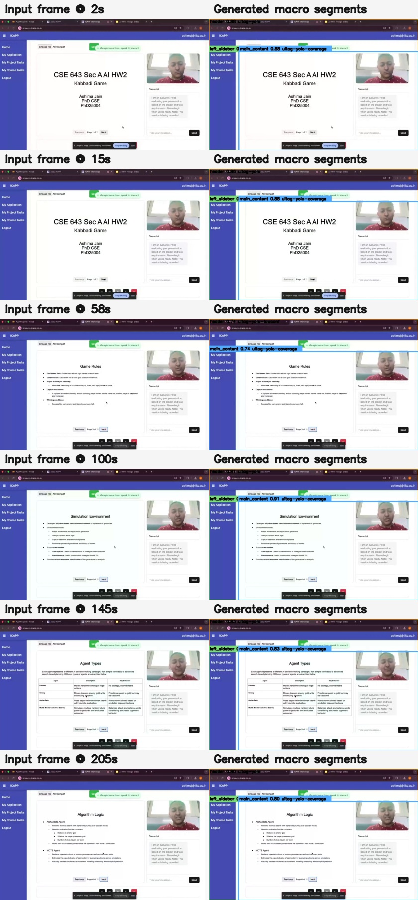
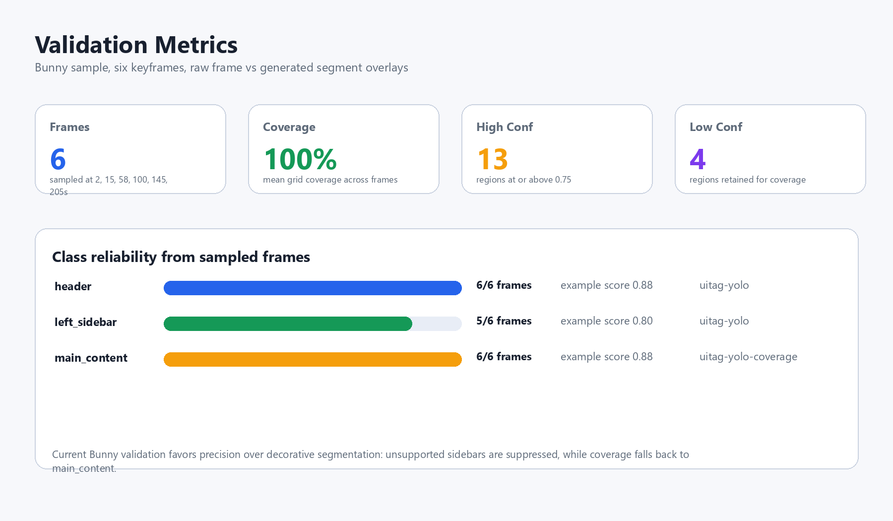
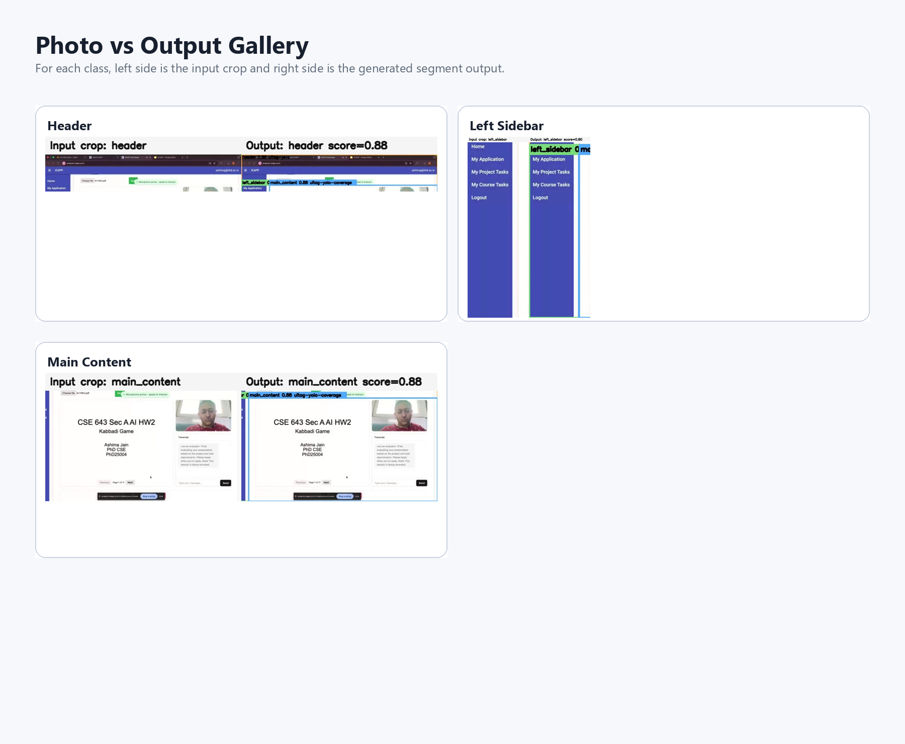

# Batch Mode

Batch mode analyzes recorded meetings and produces a durable report. It is built for long presentations, evaluated demos, course/project reviews, walkthroughs, and any session where the final artifact should be more useful than a raw transcript.

The pipeline accepts a local video file or a public MP4 URL, including Bunny CDN links. It produces structured visual events, transcript-aligned summaries, topic units, and a final Markdown report.

## Bunny Validation Source

The documentation assets in this repository are generated from:

```text
https://vz-e4eb54a1-90d.b-cdn.net/39864ba9-c74e-4cfa-a088-58ec2a08c699/play_480p.mp4
```

<p align="center">
  
</p>

## What The Pipeline Does

```text
Video URL / local MP4
  -> source resolver and downloader
  -> optional Deepgram transcript
  -> frame sampling
  -> screen mode routing
  -> cursor detection and masking
  -> macro page segmentation
  -> OmniParser UI parsing on full frames or changed crops
  -> OCR / slide / code extraction
  -> topic segmentation and topic linking
  -> report section construction
  -> mock, Gemini, OpenRouter, Qwen, or local HF writer
  -> analysis.json + report.md
```

The core trick is that the analyzer does not treat every frame as a fresh problem. It caches stable layout, reparses changed regions, carries forward unchanged UI elements, and aligns transcript windows to visual events. That keeps long videos tractable while preserving enough evidence for a readable report.

## Outputs

Typical output directory:

```text
batch_mode/outputs/<run_name>/
+-- analysis.json       # Full structured state, timings, topics, sections, writer output
`-- report.md           # Human-readable final report
```

Validation artifacts:

```text
docs/assets/
+-- segment_validation_contact_sheet.jpg
+-- class_gallery.png
+-- metrics_dashboard.png
+-- validation_metrics.json
+-- frame_0002_raw.jpg
+-- frame_0002_segments.jpg
`-- ...
```

## Current Bunny Metrics

<p align="center">
  
</p>

| Metric | Value |
| --- | ---: |
| Sampled frames | `6` |
| Sample timestamps | `2s, 15s, 58s, 100s, 145s, 205s` |
| Mean grid coverage | `100.00%` |
| High-confidence regions | `13` |
| Low-confidence retained regions | `4` |

Detected classes on the Bunny validation frames:

| Class | Detected frames | Example score | Source |
| --- | ---: | ---: | --- |
| `header` | `6 / 6` | `0.8823` | `uitag-yolo` |
| `left_sidebar` | `5 / 6` | `0.8042` | `uitag-yolo` |
| `main_content` | `6 / 6` | `0.8823` | `uitag-yolo-coverage` |

The segmentation policy now favors precision. If the detector cannot prove a real sidebar, the area remains part of `main_content` instead of being labeled as a decorative sidebar false positive.

<p align="center">
  
</p>

## Models And Methods

| Component | Model / method | Purpose |
| --- | --- | --- |
| Screen mode router | SigLIP plus sticky routing | Separates demo, slide, code, and other screens without rapid mode flapping |
| Macro layout | `swaylenhayes/uitag-yolo11s-ui-detect-v1` weights in `real_time_mode/vendor/uitag/yolo-ui.pt` | Detects coarse page regions such as header, sidebar, and main content |
| UI parsing | OmniParser icon detector and caption stack | Extracts buttons, text fields, icons, controls, and captions |
| OCR | EasyOCR / RapidOCR path through the adapter | Reads slide/code/demo text when object captions are not enough |
| Cursor | YOLO cursor detector plus motion/template fallback | Tracks pointer location, hotspot, and nearby UI target |
| Change detection | SSIM and changed-region boxes | Avoids reparsing stable screens; crop-refreshes changed areas |
| Topic grouping | BGE-M3 embeddings and temporal heuristics | Groups visual events and transcript into coherent report units |
| Report writer | Mock, Gemini, OpenRouter, local HF, Mistral, or Qwen | Produces the final Markdown report from structured sections |

## Setup

```bash
python -m venv .venv
source .venv/bin/activate
python -m pip install --upgrade pip
pip install -r batch_mode/requirements.txt
cp batch_mode/.env.example batch_mode/.env
```

Windows PowerShell:

```powershell
python -m venv .venv
.\.venv\Scripts\Activate.ps1
python -m pip install --upgrade pip
pip install -r batch_mode\requirements.txt
Copy-Item batch_mode\.env.example batch_mode\.env
```

Fill `batch_mode/.env` with real keys. For a no-LLM smoke test, keep:

```env
BATCH_LLM_BACKEND=mock
BATCH_LLM_MOCK_ENABLED=1
BATCH_LLM_USE_PREWRITTEN=1
BATCH_EMBEDDING_DEVICE=cpu
```

## Missing Large Model

The OmniParser caption model is too large for normal git storage:

```text
batch_mode/vendor/OmniParser/weights/icon_caption/model.safetensors
```

Download it after cloning:

```bash
python - <<'PY'
import os
from huggingface_hub import hf_hub_download

hf_hub_download(
    repo_id="microsoft/OmniParser-v2.0",
    filename="icon_caption/model.safetensors",
    repo_type="model",
    token=os.environ.get("HF_API_KEY", ""),
    local_dir="batch_mode/vendor/OmniParser/weights",
    local_dir_use_symlinks=False,
)
print("Downloaded OmniParser caption model.")
PY
```

PowerShell:

```powershell
@'
import os
from huggingface_hub import hf_hub_download

hf_hub_download(
    repo_id="microsoft/OmniParser-v2.0",
    filename="icon_caption/model.safetensors",
    repo_type="model",
    token=os.environ.get("HF_API_KEY", ""),
    local_dir="batch_mode/vendor/OmniParser/weights",
    local_dir_use_symlinks=False,
)
print("Downloaded OmniParser caption model.")
'@ | python -
```

Without the caption model, icon boxes and OCR still work, but semantic icon labels are weaker.

## Run Through The API

Start the local service:

```bash
python -m uvicorn batch_mode.api:app --host 0.0.0.0 --port 8000
```

Analyze the Bunny sample with a mock writer:

```bash
curl -X POST http://127.0.0.1:8000/api/analyze \
  -H "Content-Type: application/json" \
  -d '{
    "source": "https://vz-e4eb54a1-90d.b-cdn.net/39864ba9-c74e-4cfa-a088-58ec2a08c699/play_480p.mp4",
    "title": "Bunny validation sample",
    "persist_artifacts": true
  }'
```

Submit through the API to a configured Slurm cluster:

```bash
curl -X POST http://127.0.0.1:8000/api/analyze/cluster \
  -H "Content-Type: application/json" \
  -d '{
    "source": "https://vz-e4eb54a1-90d.b-cdn.net/39864ba9-c74e-4cfa-a088-58ec2a08c699/play_480p.mp4",
    "title": "Bunny cluster run",
    "persist_artifacts": true
  }'
```

Batch-submit multiple videos sequentially:

```bash
curl -X POST http://127.0.0.1:8000/api/analyze/cluster/batch \
  -H "Content-Type: application/json" \
  -d '{
    "sequential": true,
    "items": [
      {
        "source": "https://vz-e4eb54a1-90d.b-cdn.net/39864ba9-c74e-4cfa-a088-58ec2a08c699/play_480p.mp4",
        "title": "Bunny sample"
      }
    ]
  }'
```

## Run Directly On A Cluster

On the login node:

```bash
cd /path/to/Meet-Analyzer
cp batch_mode/.env.example batch_mode/.env
# edit batch_mode/.env with cluster paths, API keys, and writer backend

bash batch_mode/myproject/submit_cluster_source.sh \
  --writer mock \
  "https://vz-e4eb54a1-90d.b-cdn.net/39864ba9-c74e-4cfa-a088-58ec2a08c699/play_480p.mp4" \
  bunny_480p.mp4
```

For several sources:

```bash
bash batch_mode/myproject/submit_cluster_batch.sh \
  --writer mistral \
  --title-prefix demo_eval \
  --file links.txt
```

The submitter downloads public URLs on the login node, prepares transcript sidecars, writes a request JSON, and submits `batch_mode/myproject/sbatch_script/script.sh`. Jobs can be chained with Slurm `afterany` dependencies.

## Rebuild Validation Assets

```bash
python docs/generate_segment_validation.py \
  --source "https://vz-e4eb54a1-90d.b-cdn.net/39864ba9-c74e-4cfa-a088-58ec2a08c699/play_480p.mp4" \
  --output-dir docs/assets \
  --times "2,15,58,100,145,205" \
  --weights real_time_mode/vendor/uitag/yolo-ui.pt \
  --device cpu

python docs/build_readme_assets.py
```

PowerShell uses the same command with backticks for line continuation.

## Verification

Current local checks:

```bash
python -m pytest real_time_mode/tests/test_live_latest_frames.py real_time_mode/tests/test_macro_layout.py real_time_mode/tests/test_pipeline_modes.py batch_mode/tests/test_batch_mode.py -q
python -m py_compile real_time_mode/live_app.py real_time_mode/modal_app.py real_time_mode/config.py
```

Result:

```text
45 passed, 4 third-party deprecation warnings
```

The Bunny segmentation asset generation was also run successfully and wrote `docs/assets/validation_metrics.json`.
