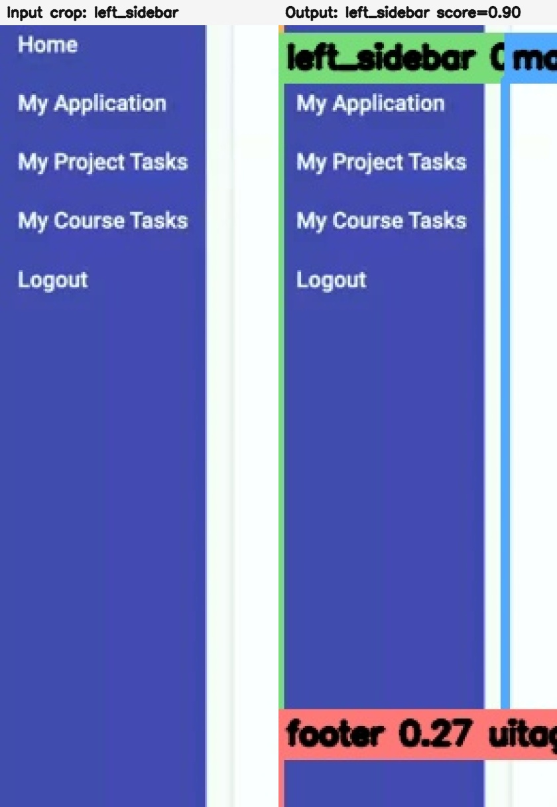
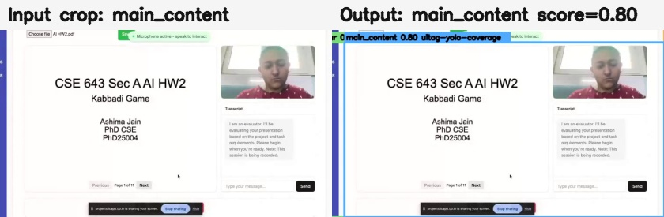
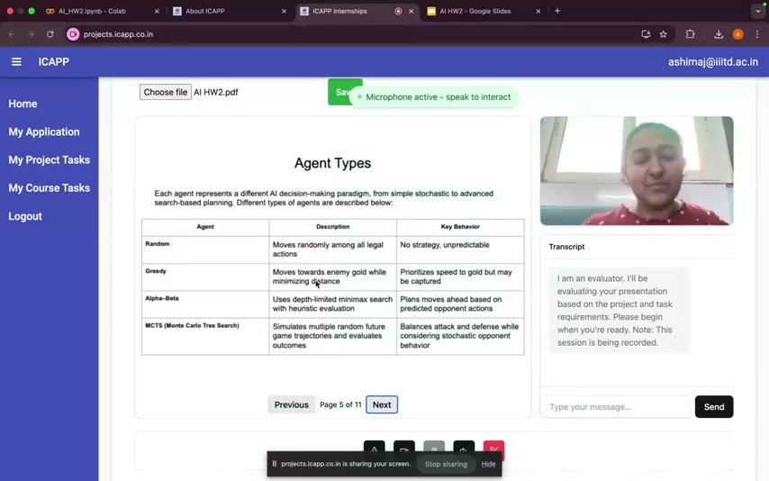
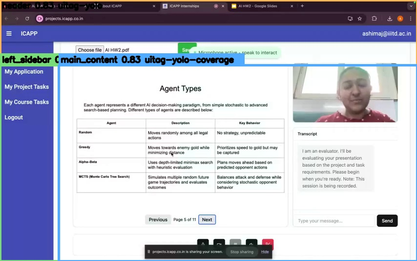

# Real-Time Mode

Real-time mode is the live screen-share version of Meet Analyzer. It captures the shared screen in the browser, filters out unchanged frames, sends only useful updates through a local FastAPI app, optionally proxies heavy work to Modal GPU, and returns live summaries, annotations, transcript context, and Supabase-ready event rows.

<p align="center">
  
</p>

## Current Status

- The browser posts to the local app at `/api/process-frame`.
- The local app proxies to Modal when `MODAL_API_BASE_URL` or `MODAL_PROCESS_FRAME_URL` is configured.
- The frontend captures at `VITE_CAPTURE_MAX_SIDE=1920` by default for OCR quality.
- Modal runs DocLayout-YOLO, OCR, cursor tracking, mode routing, and LLM summaries.
- Local Qwen fallback is disabled on Modal by default because it produced weak placeholder summaries.
- Gemini can fall through to Groq, OpenRouter, and then heuristic fallback.
- Newer screen changes can preempt older in-flight frames instead of waiting behind them.
- Recoverable transcript/audio chunk failures are warnings, not permanent microphone failures.

## Runtime Modes

There are two ways to run the real-time analyzer.

| Runtime | What runs locally | What runs remotely | Best use |
| --- | --- | --- | --- |
| Local-only | FastAPI, frontend, all models | Nothing | Development without Modal, slower unless the machine has a good GPU |
| Local proxy + Modal | FastAPI frontend/proxy, annotation, Supabase writes | SigLIP, cursor, layout, OCR, summaries, Deepgram proxy | Normal live meeting use |

The browser always talks to the local FastAPI server. That keeps API keys and Modal URLs out of browser code and avoids CORS surprises.

## End-To-End Pipeline

```text
Browser display capture
  -> 320x180 Web Worker diff
  -> one-slot latest-frame scheduler
  -> JPEG frame at up to 1920px long side
  -> local FastAPI /api/process-frame
  -> optional Modal /api/process-frame
  -> parallel mode routing and cursor detection
  -> cursor masking before server-side change detection
  -> mode-specific parser: code, slide, demo, or other
  -> transcript window attachment
  -> LLM or heuristic summary
  -> annotated image, raw record, frontend timeline, optional Supabase write
```

## Frontend Scheduler

The frontend intentionally does not process every captured frame. It keeps the newest useful frame and avoids a long backlog.

| Mechanism | Current behavior |
| --- | --- |
| Web Worker diff | Compares 320x180 grayscale frames before upload |
| `client_frame_id` | Every uploaded frame has a monotonic id |
| `VITE_MAX_IN_FLIGHT_FRAMES=2` | At most two backend requests at once |
| One pending latest frame | Replaces stale queued work instead of growing an unbounded queue |
| `VITE_SUPERSEDE_IN_FLIGHT_CHANGE_RATIO=0.10` | Navigation-size changes abort old in-flight requests and send the new frame immediately |
| `VITE_FRAME_REQUEST_TIMEOUT_MS=120000` | Prevents a stuck provider/backend call from holding a slot forever |
| Stale response guard | Late responses older than the latest applied frame are ignored |
| Raw JSON collapsed by default | Keeps the live UI fast while frames are arriving |

The backend also drops stale frames before and after the session lock. The pipeline can skip detailed LLM work for a near-duplicate frame when a newer frame is waiting, then pair the deferred frame with the next similar frame for before/after context.

## Models Used

| Layer | Model or service | Where it is used | Notes and modifications |
| --- | --- | --- | --- |
| Screen mode classifier | SigLIP/SigLIP2 through `transformers` | `SiglipScreenClassifier` | Uses a prompt bank for `slide`, `code`, `demo`, and `other/none`. The classifier uses positive and negative prompts, and the router adds sticky mode logic so a single uncertain frame does not flip modes. |
| Mode router | Local rules | `ModeRouter` | Adds high-confidence switches, consecutive-frame confirmation, sticky floor, and demo guard. OCR can correct demo frames to `code` when the visible text is clearly an editor/IDE. |
| Macro layout | `swaylenhayes/uitag-yolo11s-ui-detect-v1`, bundled as `vendor/uitag/yolo-ui.pt` | Header/sidebar/main-content segmentation | Runs tiled YOLO detection, class-aware NMS, geometry guards, sidebar false-positive rejection, boundary refinement, and fallback coverage. |
| Content layout | DocLayout-YOLO DocStructBench, `juliozhao/DocLayout-YOLO-DocStructBench` | Text/table/figure/formula/list/caption detection | Runs on full frames or changed macro regions. Labels are normalized, low-value classes are dropped, and duplicate blocks are removed by overlap. |
| OCR | EasyOCR on GPU, RapidOCR on CPU, optional PaddleOCR path | Code, slides, demo UI text, transcript-adjacent visual evidence | Real-time capture defaults to 1920px long side. OCR lines become structured `ocr_text` elements and are nested with DocLayout blocks where they overlap. |
| Slide parser | `SuryaSlideAnalyzer` contract with OCR fallback | Slide mode | Real-time mode currently uses OCR-derived slide layout, title, reading order, text, confidence, and fingerprint. If Surya is installed, the provider name can indicate Surya availability, but the current implementation keeps the deterministic OCR fallback path. |
| Cursor detector | YOLO cursor model, bundled `cursor_class_best.pt`, with template fallback | Cursor bbox, hotspot, motion, nearby target | Uses YOLO first, low-confidence patch checks, local template search around previous cursor, and motion windows. The cursor is masked/inpainted before change detection so cursor movement alone does not trigger expensive parses. |
| Change detector | Client pixel diff plus server SSIM | Upload gating and crop planning | Client diff avoids network uploads. Server SSIM and changed regions decide whether to reuse cached state, crop only changed regions, or refresh macro layout. |
| Transcript | Deepgram prerecorded API | Live audio chunks from MediaRecorder or WAV fallback | Audio chunks are normalized through ffmpeg. Tiny chunks are skipped. Recoverable bad audio chunks return warnings so the microphone path keeps listening. |
| Summarizer | Gemini, Groq, OpenRouter, heuristic fallback | Live combined summaries and segmented demo summaries | Prompts are compacted before API calls. Demo mode can summarize regions in parallel and then summarize their relationships. Modal disables local Qwen fallback by default. |
| Storage | Supabase REST | Optional meeting, frame, and transcript rows | Writes are async from the frontend and do not block screen updates. |

OmniParser files are still present in the repository because earlier validation and optional experiments used them. The active real-time path is DocLayout-YOLO plus OCR, not OmniParser.

## Model Outputs

The current model-output examples below were generated from existing meeting-share validation frames. The model outputs are also written as JSON in `docs/assets/realtime_current_model_outputs.json`.

### 1. Frontend Capture And Live UI

Output:

- frame counters,
- current mode,
- latest combined summary,
- macro/OCR counts,
- cursor target,
- debug timings,
- transcript state.

Image:

<p align="center">
  
</p>

### 2. Macro Layout Model

Model: `swaylenhayes/uitag-yolo11s-ui-detect-v1`

Output shape:

```json
[
  {"label": "header", "bbox": [0, 0, 1920, 132], "score": 0.98},
  {"label": "left_sidebar", "bbox": [0, 207, 231, 1080], "score": 0.78},
  {"label": "main_content", "bbox": [231, 132, 1920, 1080], "score": 0.98}
]
```

Annotated output:

<p align="center">
  
</p>

Earlier focused crop checks:

<p align="center">
  
  
</p>

### 3. DocLayout-YOLO Plus OCR

Model: `juliozhao/DocLayout-YOLO-DocStructBench`

OCR backend: EasyOCR on GPU or RapidOCR on CPU.

Output shape:

```json
{
  "doclayout_count": 7,
  "ocr_line_count": 94,
  "doclayout": [
    {"type": "figure", "bbox": [232, 132, 1437, 886], "confidence": 0.89},
    {"type": "text_block", "bbox": [66, 215, 192, 285], "confidence": 0.24}
  ],
  "ocr_sample": "Release Notes: 1.108.0 ... Choose what to share with projects.icapp.co.in ..."
}
```

Annotated output: magenta boxes are DocLayout blocks, green boxes are OCR text lines.

<p align="center">
  
</p>

### 4. Cursor Detector

Model: `cursor_class_best.pt` with template fallback.

Output shape:

```json
{
  "bbox": [586, 674, 600, 696],
  "confidence": 0.64,
  "motion_type": "stationary",
  "hotspot": [588, 676],
  "type": "pointer",
  "method": "yolo"
}
```

Annotated output:

<p align="center">
  
</p>

### 5. Code Mode OCR

Code mode uses OCR directly rather than macro region summaries. It emits `ocr_text`, `ocr_diff`, cursor info, and an LLM summary task of `code_detailed`.

Example frame:

<p align="center">
  
</p>

Example OCR output:

```text
Selection
File
View
agent
Edit
Run
Terminal
Help
meet_agent.py
import cv2
import numpy as np
import requests
from dotenv import load_dotenv
from google import genai
from pydantic import BaseModel, Field
```

### 6. Slide Mode

Slide mode runs:

1. SigLIP/SigLIP2 route to `slide`.
2. Cursor detection and cursor masking.
3. SSIM/changed-region check.
4. OCR-derived slide analysis with title, reading order, full text, fingerprint, and confidence.
5. Macro layout and DocLayout-YOLO in parallel.
6. Duplicate-slide suppression through the slide fingerprint.
7. LLM/heuristic slide summary.

Example slide-like validation frame and macro boxes:

<p align="center">
  
  
</p>

Output fields:

```json
{
  "mode": "slide",
  "slide_fingerprint": "...",
  "layout": [{"type": "title", "text": "...", "bbox": [x1, y1, x2, y2]}],
  "full_text": "...",
  "doclayout_elements": [],
  "screen_structure": {}
}
```

### 7. LLM Summary

The summarizer receives a compact payload rather than the full nested screen state. It includes:

- mode,
- transcript text,
- cursor text,
- page/code/slide text,
- macro region summary,
- OCR lines,
- DocLayout elements,
- recent memory,
- optional previous deferred frame.

Example output:

```md
The screen is divided into a header, left sidebar, and main content area. The left sidebar lists project files such as meet_agent.py, requirements.txt, keyframes.json, transcript.txt, and utterances.json. The main content shows a Google Meet screen-share flow with a browser dialog asking what to share, plus participant tiles and the active screen-share controls.
```

### 8. Transcript

Deepgram transcript chunks are normalized to:

```json
{
  "chunk_id": "session-0-12.4",
  "start_time": 12.4,
  "end_time": 17.8,
  "speaker": "speaker_1",
  "text": "We are reviewing the shared screen.",
  "is_final": true
}
```

Manual transcript entry in the frontend uses the same shape and is merged into the next visual summaries.

## Screen Mode Pipelines

### Code Mode

1. Route frame as `code`, or correct a demo frame to code if OCR sees IDE/editor terms.
2. Run cursor detection in parallel with route classification.
3. Inpaint/mask cursor for change detection.
4. Apply interval and SSIM thresholds: `CODE_CHANGE_TINY_RATIO` and `CODE_CHANGE_SSIM_THRESHOLD`.
5. Run full-frame OCR when the frame is new or meaningful text changed.
6. Compute `ocr_diff` from previous code text.
7. Build OCR elements and a simple full-frame content group.
8. Attach transcript window if there was a visual change.
9. Summarize with `summary_task=code_detailed`.

### Slide Mode

1. Route frame as `slide`.
2. Detect cursor and mask it before change detection.
3. Run slide interval/SSIM duplicate checks.
4. Run OCR-derived slide analysis, macro layout, and DocLayout-YOLO in parallel.
5. Build slide layout blocks, reading order, full text, title, confidence, and fingerprint.
6. Suppress duplicate slides with the fingerprint.
7. Attach transcript and summarize with `summary_task=slide_detailed`.

### Demo Mode

1. Route frame as `demo`.
2. Run cursor detection and macro layout.
3. If the macro layout is stable, only crop changed regions.
4. If a change crosses macro boundaries or covers a large area, refresh the full macro layout.
5. Run DocLayout-YOLO and OCR in parallel on the selected regions.
6. Merge reparsed elements into cached screen state.
7. Nest OCR and layout blocks into `screen_structure.regions[]` in reading order.
8. Match cursor hotspot to OCR/layout elements or parent macro region.
9. Build region payloads for header, sidebar, main content, and split main-content segments.
10. Summarize regions in parallel, then optionally summarize relationships between regions.
11. If a newer near-duplicate frame is waiting, defer expensive LLM work and pair it with the next similar frame.

### Other Mode

1. Route blank/gallery/loading/no-share frames to `other`.
2. Skip layout/OCR.
3. Keep transcript-only context when available.
4. Emit a lightweight summary and keep the UI responsive.

## Architecture Decisions And Tricks

- Same-origin browser API: the browser posts to local FastAPI, not directly to Modal.
- Latest-frame scheduling: only the freshest pending frame is kept.
- Newer-frame preemption: navigation-size changes abort older in-flight requests.
- Backend stale checks: stale frames are dropped before and after the session lock.
- Cursor masking: cursor boxes are inpainted before SSIM so pointer movement does not look like content change.
- Mode stickiness: low-confidence route changes require confirmation instead of flipping every frame.
- OCR route correction: editor/code screens misrouted as demo become `code`.
- Macro refresh policy: refresh full layout only when changed regions cross macro boundaries or cover enough of the screen.
- Crop rebasing: OCR and DocLayout boxes from crops are rebased to full-frame coordinates.
- Cache merge: unchanged regions keep previous elements while changed crops are reparsed.
- Prompt compaction: LLM calls receive compact lists and summaries, not the entire nested payload.
- Segmented demo summaries: large demo screens are summarized by region, then combined.
- Deferred near-duplicate summaries: similar frames can skip LLM work if a newer one is waiting.
- Transcript resilience: bad/silent chunks return warnings, not permanent mic failure.
- Frontend JSON throttling: raw JSON is collapsed by default during live capture.
- Supabase writes are async so persistence cannot block frame processing.

## Setup

```bash
python -m venv .venv
source .venv/bin/activate
python -m pip install --upgrade pip
pip install -r batch_mode/requirements.txt
cp real_time_mode/.env.example real_time_mode/.env
```

Windows PowerShell:

```powershell
python -m venv .venv
.\.venv\Scripts\Activate.ps1
python -m pip install --upgrade pip
pip install -r batch_mode\requirements.txt
Copy-Item real_time_mode\.env.example real_time_mode\.env
```

## Environment Defaults

Recommended live defaults:

```env
OCR_MODE=gpu
OCR_BACKEND_GPU=easyocr
OCR_BACKEND_CPU=rapidocr
DOCLAYOUT_ENABLED=1
DOCLAYOUT_REPO_ID=juliozhao/DocLayout-YOLO-DocStructBench
DOCLAYOUT_FILENAME=doclayout_yolo_docstructbench_imgsz1024.pt
DOCLAYOUT_IMGSZ=1024
FRAME_SUMMARIZER_ENABLED=1
FRAME_SUMMARIZER_PROVIDER=gemini
FRAME_SUMMARIZER_DEVICE=disabled
FRAME_SUMMARIZER_TIMEOUT_SEC=5.0
VITE_CAPTURE_MAX_SIDE=1920
VITE_FRAME_JPEG_QUALITY=0.58
VITE_MAX_IN_FLIGHT_FRAMES=2
VITE_FULL_FRAME_CHANGE_RATIO=0.55
VITE_SUPERSEDE_IN_FLIGHT_CHANGE_RATIO=0.10
VITE_FRAME_REQUEST_TIMEOUT_MS=120000
VITE_MIN_TRANSCRIPT_BLOB_BYTES=2048
VITE_TRANSCRIPT_MAX_CONSECUTIVE_ERRORS=4
```

For live latency, demo frames build OCR/layout-backed segment descriptions before any LLM call. The LLM is limited to one relationship/summary call per demo frame, and `FRAME_SUMMARIZER_TIMEOUT_SEC=5.0` makes the pipeline return the heuristic result if that call is slow.

API keys are optional by feature:

| Key | Needed for |
| --- | --- |
| `DEEPGRAM_API_KEY` | Live transcription |
| `GEMINI_API_KEY` | Gemini summaries |
| `GROQ_API_KEY` | Fast fallback summaries |
| `OPENROUTER_API_KEY` | Secondary fallback summaries |
| `HF_API_KEY` | Private or rate-limited Hugging Face downloads |
| `VITE_SUPABASE_URL`, `VITE_SUPABASE_ANON_KEY` | Optional frontend persistence |

## Model Downloads And Warmup

Bundled files:

```text
real_time_mode/vendor/uitag/yolo-ui.pt
real_time_mode/cursor_class_best.pt
real_time_mode/vendor/OmniParser/weights/icon_detect/model.pt
```

Downloaded on first warmup/cache miss:

```text
google/siglip2-large-patch16-384 or SIGLIP_MODEL_NAME override
juliozhao/DocLayout-YOLO-DocStructBench/doclayout_yolo_docstructbench_imgsz1024.pt
EasyOCR/RapidOCR OCR assets
optional local FRAME_SUMMARIZER_FALLBACK_MODEL if local fallback is enabled
```

Start the app and warm everything:

```bash
python -m uvicorn real_time_mode.live_app:app --host 127.0.0.1 --port 8765
```

PowerShell warmup call:

```powershell
Invoke-RestMethod -Method Post -Uri http://127.0.0.1:8765/api/warmup
```

Optional explicit DocLayout download:

```powershell
@'
from huggingface_hub import hf_hub_download
print(hf_hub_download(
    repo_id="juliozhao/DocLayout-YOLO-DocStructBench",
    filename="doclayout_yolo_docstructbench_imgsz1024.pt",
))
'@ | python -
```

## Run Locally

```bash
python -m uvicorn real_time_mode.live_app:app --host 127.0.0.1 --port 8765
```

Open:

```text
http://127.0.0.1:8765
```

Use **Start Session + Share**. The app requests screen-share permission, starts warmup, requests microphone access when available, then begins live capture.

## Modal GPU Endpoint

Install and connect Modal:

```bash
python -m pip install modal
python -m modal setup
```

Create/update the Modal secret named `real-time-mode-secrets` with the same server-side keys used in `real_time_mode/.env`. Example:

```bash
python -m modal secret create real-time-mode-secrets \
  GEMINI_API_KEY=... \
  GROQ_API_KEY=... \
  OPENROUTER_API_KEY=... \
  DEEPGRAM_API_KEY=... \
  HF_API_KEY=...
```

Deploy:

```bash
python -m modal deploy real_time_mode/modal_app.py
```

Then configure the local proxy:

```env
MODAL_API_BASE_URL=https://<modal-app-url>
```

or:

```env
MODAL_PROCESS_FRAME_URL=https://<modal-app-url>/api/process-frame
```

The Modal image installs the GPU runtime dependencies, mounts the project into `/root/project`, uses an L4 GPU, and caches downloads in the `real-time-mode-cache` volume.

## Supabase Persistence

Schema:

```text
real_time_mode/supabase/schema.sql
```

Environment:

```env
VITE_SUPABASE_URL=
VITE_SUPABASE_ANON_KEY=
```

Tables written by the frontend:

| Table | Purpose |
| --- | --- |
| `meetings` | Session metadata |
| `frame_events` | Visual records, summaries, annotations, debug timings |
| `transcript_segments` | Live transcript fragments |

## Frontend Features

- Screen-share session controls.
- Live preview and annotated output image.
- Counters for submitted, completed, queued, skipped, stale-dropped, pending queue, and in-flight frames.
- Latest-frame gap and analysis lag.
- Mode confidence and route decision path.
- Macro layout, DocLayout block counts, and OCR text counts.
- Cursor target display.
- Transcript capture plus manual transcript fallback.
- Collapsible raw JSON and debug timing panels.
- Supabase status.

## Rebuild README Assets

The current real-time model-output images can be regenerated with the adapters directly, without Modal or LLM calls. This uses the validation frame at `real_time_mode/validation_runs_gpu/browser_demo_gpu/frames/frame_1160.0s.png`.

```powershell
@'
from pathlib import Path
import cv2
from real_time_mode.config import NewRealtimeSettings
from real_time_mode.macro_layout import MacroLayoutDetector
from real_time_mode.doclayout_adapter import DocLayoutYOLOAdapter
from real_time_mode.ocr_adapter import OCRTextExtractor

settings = NewRealtimeSettings.from_env()
frame = cv2.imread("real_time_mode/validation_runs_gpu/browser_demo_gpu/frames/frame_1160.0s.png")
macro = MacroLayoutDetector(settings.macro_layout_model_ref, settings.macro_layout_model_filename)
doc = DocLayoutYOLOAdapter(repo_id=settings.doclayout_repo_id, filename=settings.doclayout_filename, device="cpu")
ocr = OCRTextExtractor(requested_mode="cpu", ocr_lang=settings.ocr_lang)
groups = macro.detect(frame)
regions = [group.bbox for group in groups]
doc_payload = doc.detect_regions(frame, regions, frame_id=1, timestamp_sec=0)
ocr_payload = ocr.extract_regions(frame, regions, frame_type="demo")
print(len(groups), len(doc_payload.elements), len(ocr_payload.lines))
'@ | python -
```

The older Bunny validation assets can still be rebuilt:

```bash
python docs/generate_segment_validation.py \
  --raw-frames "docs/assets/frame_0002_raw.jpg,docs/assets/frame_0058_raw.jpg,docs/assets/frame_0100_raw.jpg,docs/assets/frame_0145_raw.jpg,docs/assets/frame_0205_raw.jpg" \
  --output-dir docs/assets \
  --weights real_time_mode/vendor/uitag/yolo-ui.pt \
  --device cpu

python docs/build_readme_assets.py
```

## Tests

Real-time focused tests:

```bash
python -m pytest real_time_mode/tests -q
```

Full repository tests:

```bash
python -m pytest real_time_mode/tests batch_mode/tests -q
```

Current result:

```text
52 passed, 4 third-party deprecation warnings
```
