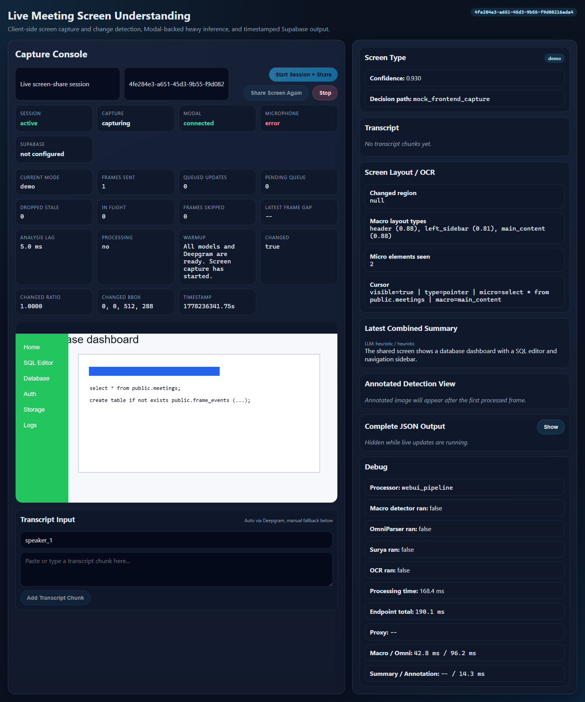
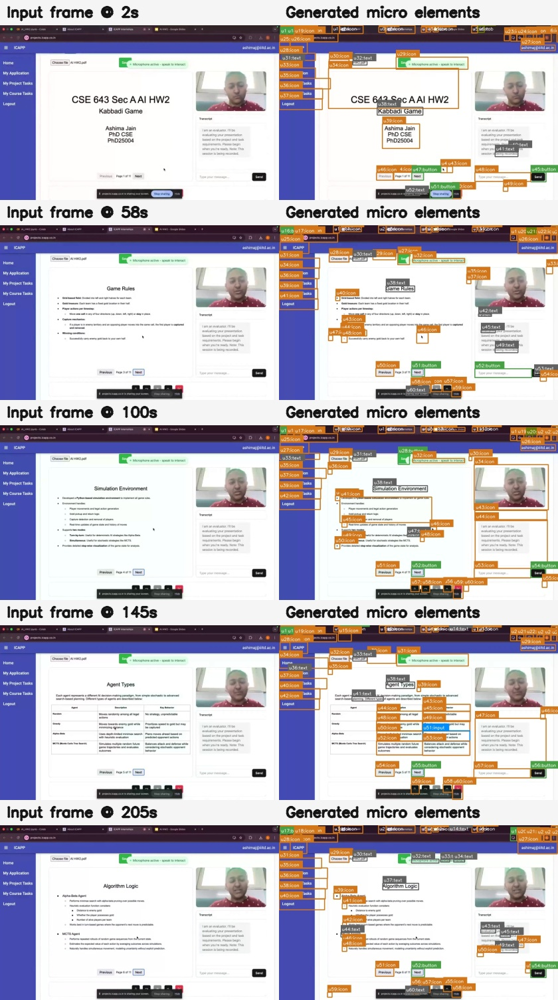
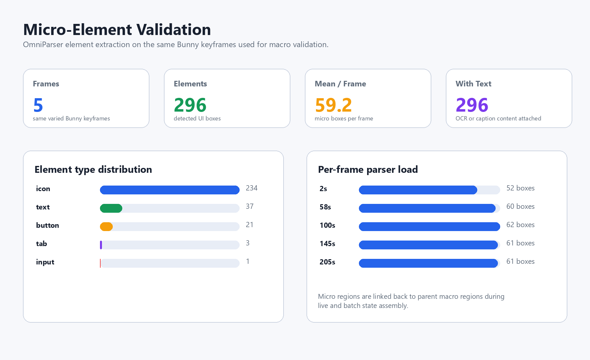

# Real-Time Mode

Real-time mode is the live screen-share analyzer. It captures frames in the browser, runs client-side change detection, sends meaningful updates to the backend, and returns structured visual events fast enough for an active meeting timeline.

<p align="center">
  
</p>

## What It Does

- Captures screen-share frames directly in the browser.
- Uses a Web Worker diff pass before upload.
- Sends frames with `client_frame_id` sequencing.
- Allows limited concurrent in-flight requests.
- Aborts or ignores stale responses when a newer frame supersedes them.
- Routes frames into demo, slide, code, or other modes.
- Tracks cursor location, hotspot, and nearby target.
- Segments the page into macro regions.
- Extracts micro UI elements with OmniParser.
- Reads screen text through OCR and slide/code adapters.
- Produces summaries, annotated images, raw records, and Supabase-ready payloads.

The practical goal is that a tab switch during screen sharing should not wait behind a long queue of old frames. Fresh full-screen changes are allowed to overtake stale work.

## Live Architecture

```text
Browser screen capture
  -> canvas resize and JPEG compression
  -> Web Worker diff
  -> latest-frame scheduler
  -> FastAPI local endpoint
  -> optional Modal GPU endpoint
  -> mode router
  -> cursor detector
  -> macro page segmentation
  -> OmniParser / OCR / slide parser
  -> summary and annotation
  -> frontend timeline and optional Supabase persistence
```

## Frontend Latency Design

The frontend does not post every captured frame blindly. It keeps only the freshest useful work:

| Mechanism | Purpose |
| --- | --- |
| `client_frame_id` | Lets frontend and backend agree which response is newest |
| `VITE_MAX_IN_FLIGHT_FRAMES=2` | Allows limited overlap without building a long queue |
| AbortController | Cancels older full-frame work on large tab changes |
| Stale response guard | Prevents old responses from overwriting the current UI |
| Raw JSON collapsed by default | Avoids expensive rendering during live capture |
| Worker diff | Skips unchanged frames before network upload |

The backend also drops stale frames before and after the session lock, so late results cannot corrupt the current screen state.

## Macro And Micro Validation

Real-time mode shares the same core macro and micro analyzers used by batch mode. The Bunny validation set uses five varied states: title screen, game rules, simulation environment, agent table, and algorithm logic.

<p align="center">
  
</p>

<p align="center">
  
</p>

Macro metrics:

| Metric | Value |
| --- | ---: |
| Sampled frames | `5` |
| Mean grid coverage | `100.00%` |
| High-confidence regions | `11` |
| Low-confidence retained regions | `4` |
| Classes emitted | `header`, `left_sidebar`, `main_content` |

Micro metrics:

| Metric | Value |
| --- | ---: |
| OmniParser elements | `296` |
| Mean elements per frame | `59.2` |
| Interactive elements | `259` |
| Text/caption-bearing elements | `296` |

<p align="center">
  
</p>

## Model Stack

| Component | Model or method | Runtime role |
| --- | --- | --- |
| Capture scheduler | Browser canvas, JPEG compression, worker diff | Sends compact frames only when useful |
| Mode router | SigLIP/SigLIP2 prompt bank and sticky routing | Chooses demo, slide, code, or other |
| Macro segmentation | yolo-ui detector plus geometry guards | Finds header, sidebar, and main content without over-labeling sidebars |
| Micro parsing | OmniParser v2 icon detector/caption stack | Extracts controls, icons, text regions, and visible UI boxes |
| OCR | EasyOCR on GPU by default, RapidOCR for CPU fallback, optional PaddleOCR path | Reads slide, code, and live UI text |
| Slide adapter | OCR-derived layout in real-time; compatible with the batch Surya contract | Emits slide title, layout blocks, reading order, and fingerprints |
| Cursor | YOLO cursor model plus fallback logic | Tracks pointer hotspot and target element |
| Change detector | SSIM and changed-pixel regions | Reuses cache and reparses changed crops |
| Summarizer | Heuristic or Gemini-backed frame summarizer | Turns structured state into live language |
| Persistence | Supabase REST tables | Stores meetings, frame events, and transcript segments |
| Remote GPU | Modal app | Moves heavier parsing away from the local frontend host |

Note on Surya: batch mode includes the full Surya layout/OCR predictor path. Real-time mode keeps the same slide-analysis contract but favors a lighter OCR-derived layout path for live latency unless the analyzer is extended with the heavier predictors.

## Demo-Mode Structure

Demo frames now emit a research-friendly `screen_structure` payload. The pipeline first detects macro regions, then reads each changed crop with OmniParser and RapidOCR. Within each macro region, nodes are sorted top-to-bottom and left-to-right. If an OmniParser element sits inside an OCR text box, it becomes a child of that OCR node; if OCR sits inside a UI element, the OCR node is attached under that UI element. This keeps visible text and controls together instead of forcing downstream agents to reconcile two flat lists.

The live crop policy is:

1. Detect visual change after cursor masking.
2. If the change is contained inside existing macro regions, rerun OmniParser and OCR only on those changed regions.
3. If region boundaries change, the page layout is refreshed and OmniParser/OCR run across the full screen.

## Setup

```bash
python -m venv .venv
source .venv/bin/activate
python -m pip install --upgrade pip
pip install -r batch_mode/requirements.txt
cp real_time_mode/.env.example real_time_mode/.env
```

Windows PowerShell:

```powershell
python -m venv .venv
.\.venv\Scripts\Activate.ps1
python -m pip install --upgrade pip
pip install -r batch_mode\requirements.txt
Copy-Item real_time_mode\.env.example real_time_mode\.env
```

Recommended live defaults:

```env
OCR_MODE=gpu
OCR_BACKEND_GPU=easyocr
OCR_BACKEND_CPU=rapidocr
OMNIPARSER_IMGSZ=512
VITE_CAPTURE_MAX_SIDE=512
VITE_FRAME_JPEG_QUALITY=0.46
VITE_MAX_IN_FLIGHT_FRAMES=2
VITE_FULL_FRAME_CHANGE_RATIO=0.55
```

## Missing Large Model

The OmniParser caption checkpoint is not committed:

```text
real_time_mode/vendor/OmniParser/weights/icon_caption/model.safetensors
```

Download it when full semantic icon captions are needed:

```bash
python - <<'PY'
import os
from huggingface_hub import hf_hub_download

hf_hub_download(
    repo_id="microsoft/OmniParser-v2.0",
    filename="icon_caption/model.safetensors",
    repo_type="model",
    token=os.environ.get("HF_API_KEY", ""),
    local_dir="real_time_mode/vendor/OmniParser/weights",
    local_dir_use_symlinks=False,
)
print("Downloaded OmniParser caption model.")
PY
```

Without this file, full OmniParser v2 will download the missing checkpoint when `HF_API_KEY` is available. With no token and no checkpoint, macro segmentation, cursor detection, OCR, and frontend scheduling tests can still run, but OmniParser micro-element captioning is unavailable.

## Run Locally

```bash
python -m uvicorn real_time_mode.live_app:app --host 127.0.0.1 --port 8765
```

Open:

```text
http://127.0.0.1:8765
```

Use **Start Session + Share**. The app requests screen-share permission, warms the runtime, then starts live capture.

## Modal GPU Endpoint

Deploy:

```bash
modal deploy real_time_mode/modal_app.py
```

Then set:

```env
MODAL_API_BASE_URL=https://<modal-app-url>
```

or:

```env
MODAL_PROCESS_FRAME_URL=https://<modal-app-url>/api/process-frame
```

The browser always posts to the local FastAPI app. The local app proxies to Modal when configured.

## Supabase Persistence

Schema:

```text
real_time_mode/supabase/schema.sql
```

Environment:

```env
VITE_SUPABASE_URL=
VITE_SUPABASE_ANON_KEY=
```

Tables written by the frontend:

| Table | Purpose |
| --- | --- |
| `meetings` | Session metadata |
| `frame_events` | Visual records, summaries, annotations, debug timings |
| `transcript_segments` | Live transcript fragments |

## Frontend Features

- Screen-share session controls.
- Live preview and annotated output image.
- Counters for sent, queued, skipped, stale-dropped, and in-flight frames.
- Latest-frame gap and analysis lag.
- Mode confidence and route details.
- Macro layout and micro element counts.
- Cursor target display.
- Transcript input and live transcript state.
- Collapsible raw JSON and debug timing panels.

## Rebuild Validation Assets

```bash
python docs/generate_segment_validation.py \
  --raw-frames "docs/assets/frame_0002_raw.jpg,docs/assets/frame_0058_raw.jpg,docs/assets/frame_0100_raw.jpg,docs/assets/frame_0145_raw.jpg,docs/assets/frame_0205_raw.jpg" \
  --output-dir docs/assets \
  --weights real_time_mode/vendor/uitag/yolo-ui.pt \
  --device cpu

python docs/generate_micro_validation.py \
  --frames "docs/assets/frame_0002_raw.jpg,docs/assets/frame_0058_raw.jpg,docs/assets/frame_0100_raw.jpg,docs/assets/frame_0145_raw.jpg,docs/assets/frame_0205_raw.jpg" \
  --output-dir docs/assets \
  --repo-dir real_time_mode/vendor/OmniParser \
  --weights-dir real_time_mode/vendor/OmniParser/weights \
  --imgsz 512

python docs/build_readme_assets.py
```

## Tests

Real-time focused tests:

```bash
python -m pytest real_time_mode/tests -q
```

Full repository tests:

```bash
python -m pytest real_time_mode/tests batch_mode/tests -q
```

Current result:

```text
47 passed, 4 third-party deprecation warnings
```

Frontend concurrency was verified with Playwright against the live app shell using mocked screen-share frames and intentionally slow backend responses. The latest run sent frame IDs `1` through `12`, observed `maxConcurrent = 2`, returned frame `2` before the deliberately slow frame `1`, applied a newer frame before the stale response, rendered `main_content`, rendered the micro count, and showed no false `left_sidebar`.
